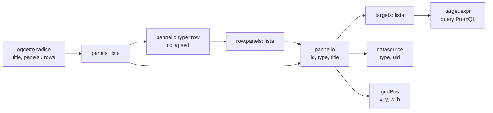
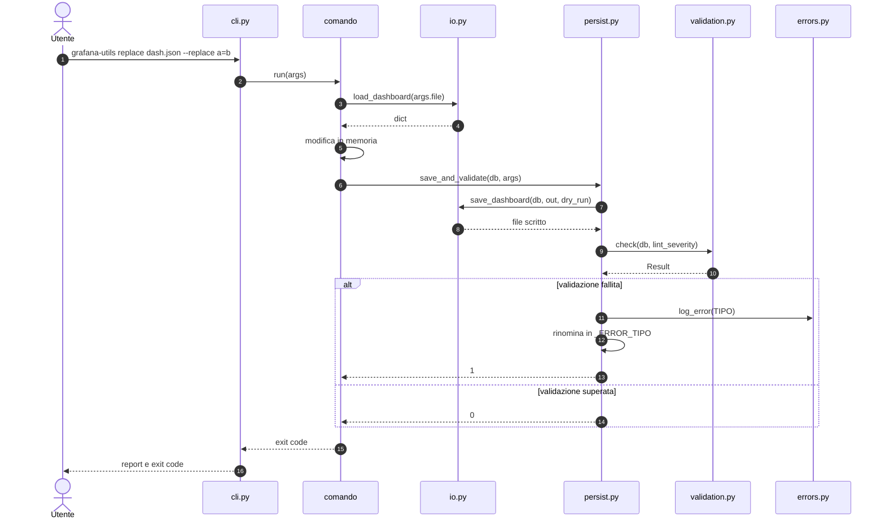
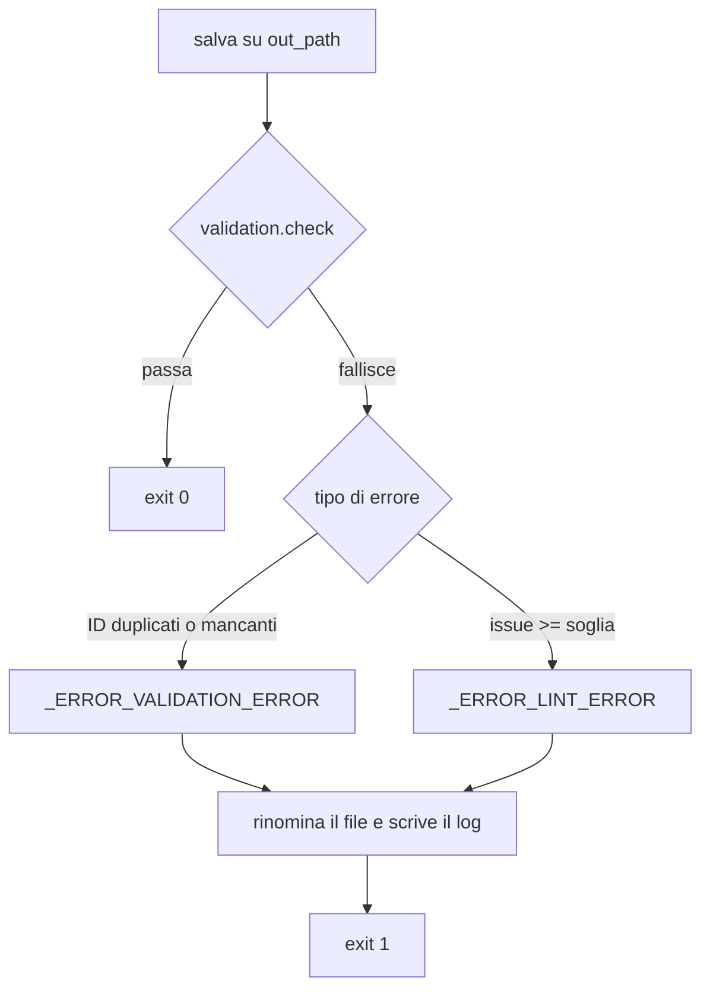
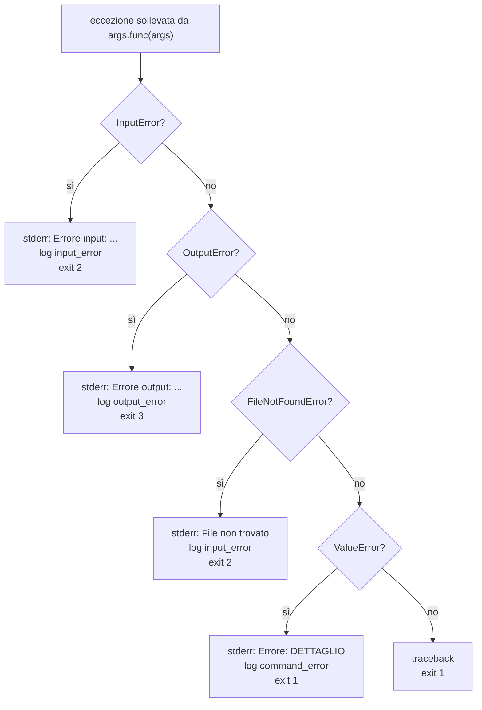

# grafana-tool

CLI modulare per manipolare dashboard Grafana (JSON) da terminale.

Il progetto segue il **Single Responsibility Principle**: ogni file ha una sola responsabilità, ogni sottocomando vive in un proprio modulo, la CLI fa solo wiring. Versione corrente: **3.1.0**.

Garanzie del contratto:

- il **file di input non viene mai modificato**;
- ogni comando di scrittura produce **sempre un file di output**;
- gli oggetti creati hanno **identificativi nuovi** (uid dashboard, id pannelli) e non riusano quelli già noti;
- la **validazione finale** (struttura + lint) è l'ultimo passo di ogni modifica;
- ogni errore produce un **log** in `out/` e un exit code dedicato;
- nessuna dipendenza esterna (solo standard library).

---

## Indice

1. [Installazione e avvio](#installazione-e-avvio)
2. [Modello dati](#modello-dati)
3. [Interfaccia CLI](#interfaccia-cli)
4. [Nomi dei file e contratto I/O](#nomi-dei-file-e-contratto-io)
5. [Opzioni comuni dei comandi di scrittura](#opzioni-comuni-dei-comandi-di-scrittura)
6. [Identità e nomi degli oggetti in output](#identità-e-nomi-degli-oggetti-in-output)
7. [Pipeline di scrittura e validazione](#pipeline-di-scrittura-e-validazione)
8. [Errori e log](#errori-e-log)
9. [Comandi read-only](#comandi-read-only)
10. [Comandi di scrittura](#comandi-di-scrittura)
11. [Exit code](#exit-code)
12. [Linter](#linter)
13. [Architettura](#architettura)
14. [Messaggi stampati](#messaggi-stampati)
15. [Ricette](#ricette)
16. [Limiti noti](#limiti-noti)

---

## Installazione e avvio

### Requisiti

- Python **3.9+**;
- nessuna dipendenza di runtime (`dependencies = []` in `pyproject.toml`);
- build con `setuptools>=61`.

### Installazione

```bash
# dalla radice del repository
python3 -m pip install -e .
```

### Due modi di avvio

```bash
grafana-utils --version          # console script
python3 -m grafana_tool --version  # modulo, via __main__.py
```

Entrambi stampano `grafana-utils 3.1.0`.

```toml
[project.scripts]
grafana-utils = "grafana_tool.cli:main"
```

---

## Modello dati

Il file è un oggetto JSON. Una dashboard contiene righe e pannelli:

- **schema moderno**: `panels` mescola pannelli e contenitori `type: "row"`, i cui figli stanno in `row.panels`;
- **schema legacy**: la lista `rows` contiene direttamente le righe;
- **riga espansa**: se `row.collapsed` è `false` Grafana **non** mette i figli in `row.panels`: i pannelli restano top-level subito dopo la riga, fino alla riga successiva. È il caso della riga "VISTA SISTEMISTICA" nella dashboard di produzione in `examples/`.

`model.row_children(db, row)` restituisce i pannelli della riga in entrambe le rappresentazioni; tutti i comandi che ragionano "per riga" passano da lì.



`model.py` distingue tre attraversamenti:


| Funzione                                      | Comportamento e valore di ritorno                                                                                                                                          |
| ----------------------------------------------- | ---------------------------------------------------------------------------------------------------------------------------------------------------------------------------- |
| `iter_panels(panels)`                         | Itera ricorsivamente i pannelli di una lista, inclusi quelli annidati in `panels`. Ignora gli elementi non-dict.                                                           |
| `iter_rows(db)`                               | Itera le righe unendo `db["panels"]` (solo `type=row`) e `db["rows"]`, senza duplicati per identità.                                                                      |
| `iter_all_panels(db)`                         | Itera tutti i pannelli, righe comprese, sia da `panels` sia da `rows`, senza duplicati.                                                                                    |
| `iter_content_panels(db)`                     | Come `iter_all_panels` ma esclude `type=row`.                                                                                                                              |
| `expanded_row_siblings(db, row)`              | Pannelli top-level che seguono una riga espansa fino alla riga successiva; lista vuota se la riga non è in `db["panels"]`.                                                |
| `row_children(db, row)`                       | Pannelli della riga: `row["panels"]` se presente e non vuoto; altrimenti, per `collapsed is False`, i fratelli top-level; altrimenti lista vuota.                          |
| `iter_rows_with_children(db)`                 | Coppie `(riga, pannelli)` risolte con `row_children`.                                                                                                                      |
| `iter_panels_with_parent(db)`                 | Coppie `(riga, pannello)` per ogni pannello di contenuto; `riga = None` per i pannelli top-level fuori riga. Non ripete i pannelli già visti.                             |
| `find_row_container(db, row_id)`              | `(lista_contenitrice, indice)` della riga, oppure `(None, -1)`.                                                                                                            |
| `find_row(db, row_id)`                        | Riga con quell'`id`, oppure `None`.                                                                                                                                        |
| `find_panel_container(db, panel_id)`          | `(lista_contenitrice, indice)` del pannello: top-level, dentro una riga o in `rows`. `(None, -1)` se assente.                                                              |
| `find_panel_parent_row(db, panel_id)`         | Riga che contiene il pannello, oppure `None` se è top-level.                                                                                                              |
| `get_max_id(db)`                              | Massimo `id` intero tra tutti i pannelli, righe comprese; `0` se non ce ne sono.                                                                                           |
| `collect_scope(db, row_id)`                   | Lista piatta dei pannelli di contenuto dell'intera dashboard (`row_id=None`) o di una riga. Solleva `ValueError` se la riga non esiste.                                    |
| `max_y(db)`                                   | Massimo `gridPos.y + gridPos.h` tra tutti i pannelli, annidati compresi.                                                                                                   |
| `title_regex(pattern)`                        | Compila `re.compile(pattern, re.IGNORECASE)`: punto unico per l'identificazione per nome.                                                                                  |
| `find_row_container_by_title(db, pattern)`    | `(contenitore, indice, riga)` della prima riga il cui titolo matcha la regex case-insensitive; `(None, -1, None)` se nessuna.                                              |
| `find_row_by_title(db, pattern)`              | Prima riga il cui titolo matcha `pattern`, oppure `None`.                                                                                                                  |
| `renumber_ids(obj, base_id)`                  | Assegna `obj["id"]`, poi id consecutivi ai figli e ai nipoti. Ritorna il primo id libero dopo quelli assegnati.                                                            |
| `insert_row_after_block(db, row_id, new_row)` | Inserisce `new_row` dopo l'ultimo elemento del blocco della riga (per una riga espansa, dopo i fratelli top-level). Ritorna l'indice usato.                                |
| `remove_row_block(db, row_id)`                | Rimuove la riga e i suoi pannelli: per una riga collassata `row["panels"]`, per una espansa i fratelli top-level. Ritorna quanti pannelli di contenuto sono stati rimossi. |
| `append_to_row_block(db, row, panel)`         | Aggiunge `panel` dentro `row["panels"]` per una riga collassata/legacy; per una riga espansa lo inserisce top-level in coda al blocco.                                     |
| `min_grid_y(db_or_panels)`                    | Minimo `gridPos.y` tra i pannelli di una dashboard o di una lista; `0` se non ci sono `gridPos`.                                                                           |
| `shift_grid_y(panels, delta)`                 | Somma `delta` a `gridPos.y` di ogni pannello, annidati compresi; no-op con `delta = 0`.                                                                                    |

I comandi che modificano contenuti (`replace`, `transform`, `set-datasource`, `prune`, `list-panels`) lavorano sui **pannelli di contenuto**: una riga non riceve mai query, datasource o titolo.

---

## Interfaccia CLI


| Opzione globale | Effetto                              |
| ----------------- | -------------------------------------- |
| `-h`, `--help`  | Uso e lista dei sottocomandi, exit 0 |
| `--version`     | `grafana-utils 3.1.0`, exit 0        |

Il parser richiede un sottocomando: invocare `grafana-utils` senza comando è un errore d'uso, exit 2, registrato come `USAGE_ERROR`.

### Comandi


| Comando          | Cosa fa                                        | Scrive | Valida    |
| ------------------ | ------------------------------------------------ | -------- | ----------- |
| `list-rows`      | Elenca le righe                                | —     | —        |
| `list-panels`    | Elenca i pannelli con la riga di appartenenza  | —     | —        |
| `validate`       | Struttura + lint, come passo finale            | —     | sì       |
| `lint`           | Solo regole di best practice                   | —     | solo lint |
| `duplicate-row`  | Crea una nuova riga copiando un'altra          | sì    | sì       |
| `copy-panel`     | Duplica un pannello con un nuovo `id`          | sì    | sì       |
| `move-panel`     | Sposta un pannello in un'altra riga            | sì    | sì       |
| `replace`        | Sostituzioni testuali in `target[*].expr`      | sì    | sì       |
| `transform`      | Modifica i pannelli che matchano tipo o titolo | sì    | sì       |
| `prune`          | Rimuove pannelli per id, titolo o tipo         | sì    | sì       |
| `set-datasource` | Cambia `uid`/`type` del datasource             | sì    | sì       |
| `reflow`         | Ricalcola `gridPos` sulla griglia              | sì    | sì       |
| `append-row`     | Aggiunge una row parametrizzata alla dashboard | sì    | sì       |
| `extract-row`    | Estrae una row in una dashboard minima         | sì    | sì       |

---

## Nomi dei file e contratto I/O

### Input

Il file di input deve esistere e contenere un oggetto JSON. **Non viene mai scritto**: nessun comando apre l'input in scrittura.


| Situazione               | Eccezione    | Exit |
| -------------------------- | -------------- | ------ |
| Il path non esiste       | `InputError` | 2    |
| Il path è una directory | `InputError` | 2    |
| JSON malformato          | `InputError` | 2    |
| Errore di lettura        | `InputError` | 2    |
| Radice non oggetto       | `InputError` | 2    |

### Output


| Situazione                       | Nome del file                                                    |
| ---------------------------------- | ------------------------------------------------------------------ |
| Scrittura riuscita, `-o` omesso  | `<input>_out.json` (stessa directory)                            |
| Scrittura riuscita, `-o FILE`    | `FILE`                                                           |
| Validazione fallita, `-o` omesso | `<input>_out_ERROR_<TIPO>.json`                                  |
| Validazione fallita, `-o FILE`   | `<stem di FILE>_ERROR_<TIPO>.json`                               |
| `--dry-run`                      | Nessun file; se la validazione fallisce stampa il nome ipotetico |

Esempi:

```text
dashboard.json                       → dashboard_out.json
dashboard.json + errore di lint      → dashboard_out_ERROR_LINT_ERROR.json
dashboard.json -o build/new.json     → build/new.json
build/new.json + errore strutturale  → build/new_ERROR_VALIDATION_ERROR.json
```

I due soli `<TIPO>` che compaiono nel nome del file sono `VALIDATION_ERROR` (ID duplicati o mancanti) e `LINT_ERROR` (issue oltre soglia). Gli altri errori non producono un file di output, solo un log.

### Scrittura

`io.save_dashboard` crea le directory genitore mancanti, sovrascrive il file di output se esiste e serializza con `json.dump(indent=2, ensure_ascii=False)` più un newline finale. Con `dry_run=True` non tocca il disco.

---

## Opzioni comuni dei comandi di scrittura

`cli_common.add_write_options(parser)` aggiunge a ogni comando di scrittura:


| Flag                  | Destinazione `argparse` | Valori                     | Default | Effetto                                      |
| ----------------------- | ------------------------- | ---------------------------- | --------- | ---------------------------------------------- |
| `-o`, `--output FILE` | `args.output`           | path                       | `None`  | File di output; se omesso `<input>_out.json` |
| `--dry-run`           | `args.dry_run`          | flag                       | `False` | Non scrive nulla                             |
| `--lint-severity`     | `args.lint_severity`    | `info`, `warning`, `error` | `error` | Soglia che fa fallire la validazione finale  |

Un solo flag sostituisce la vecchia coppia `--lint-min-severity` / `--fail-on-lint`: mostra sempre tutte le issue e fallisce sopra la soglia, così non può più capitare un exit 1 senza messaggi.

Le versioni precedenti avevano anche `--no-lint`: è stato rimosso, perché la validazione finale non è disattivabile.

`cli_common.add_title_options(parser)` aggiunge ai comandi che creano righe o pannelli:


| Flag              | Destinazione `argparse` | Default | Effetto                                                                                    |
| ------------------- | ------------------------- | --------- | -------------------------------------------------------------------------------------------- |
| `--dedupe-titles` | `args.dedupe_titles`    | `False` | Aggiunge ` (2)`, ` (3)` ai titoli creati che ripetono un titolo già presente in dashboard |

Il default è conservativo: i titoli restano identici alla sorgente, perché in Grafana il titolo è un'etichetta e non una chiave. La disambiguazione si attiva quando servono nomi univoci nella stessa dashboard.

---

## Identità e nomi degli oggetti in output

Il tool non interroga Grafana. Quello che può garantire è che **gli identificativi scritti nel file di output non riusino quelli già noti** (dashboard sorgente e inventario passato con `--existing-dashboards`). La logica vive in `identity.py`, che è pura: riceve i valori occupati e restituisce i nuovi.

### Tre livelli di identità


| Livello   | Campo              | Universo                 | Regola applicata                                                                        |
| ----------- | -------------------- | -------------------------- | ----------------------------------------------------------------------------------------- |
| Dashboard | `uid`              | globale nell'istanza     | `extract-row` ne genera uno nuovo di 9 caratteri, mai presente tra i valori noti        |
| Dashboard | `id`               | database Grafana         | `extract-row` scrive `null`: Grafana crea una dashboard, non ne aggiorna una            |
| Dashboard | `version`          | per dashboard            | `extract-row` scrive `1`, coerente con una dashboard appena creata                      |
| Dashboard | `title`            | etichetta                | reso unico con ` (2)`, ` (3)` rispetto a sorgente e inventario                          |
| Pannello  | `id`               | solo dentro la dashboard | i comandi che creano pannelli partono da `max + 1`; `extract-row` da `max sorgente + 1` |
| Pannello  | `title`            | etichetta                | invariato; con `--dedupe-titles` diventa unico nella dashboard                          |
| Libreria  | `libraryPanel.uid` | globale                  | mai riscritto: il linter segnala `SHARED_LIBRARY_PANEL`                                 |

`uid` e `id` della dashboard sono l'unica vera chiave: finché cambiano, importare il file crea un oggetto nuovo. I titoli non sono chiavi in Grafana, quindi il default li lascia invariati e la disambiguazione è opt-in.

**L'identificazione per nome è sempre case-insensitive.** Tutti i filtri che cercano righe, pannelli o dashboard confrontano i titoli con `re.IGNORECASE` (`model.title_regex`) e con `casefold()` per unicità e inventario; anche `--match-type` confronta il tipo senza distinguere maiuscole e minuscole. `--row-match "sistemistica"`, `--match-title "^pod"` e `--match-type "TimeSeries"` funzionano come le rispettive forme maiuscole.

### API di `identity.py`


| Funzione                                                                          | Comportamento                                                                                                                                                                                                |
| ----------------------------------------------------------------------------------- | -------------------------------------------------------------------------------------------------------------------------------------------------------------------------------------------------------------- |
| `new_uid(length=9)`                                                               | Genera un uid casuale con `secrets.choice` sull'alfabeto `A-Za-z0-9`. `ValueError` se `length < 1`.                                                                                                          |
| `new_uid_not_in(taken, length=9)`                                                 | Rigenera finché il candidato non compare in `taken` (confronto `casefold`).                                                                                                                                 |
| `normalize_title(title)`                                                          | Forma di confronto: spazi compattati con `split()`, poi `casefold`. `None` e stringhe vuote diventano `""`.                                                                                                  |
| `unique_title(base, taken, start=2)`                                              | Ritorna `base` se libero, altrimenti `base (2)`, `base (3)`, ... fino al primo libero. Titolo vuoto diventa `Senza titolo`.                                                                                  |
| `all_titles(db)`                                                                  | Titoli non vuoti di righe e pannelli (ricorsivo).                                                                                                                                                            |
| `panel_titles(db)`                                                                | Come `all_titles` ma esclude le righe.                                                                                                                                                                       |
| `dedupe_panel_titles(panels, taken=())`                                           | Rende unici i titoli dei pannelli indicati, annidati compresi; le righe sono saltate. Accumula i nomi già usati, quindi gestisce anche le collisioni interne al gruppo. Ritorna quanti titoli ha riscritto. |
| `iter_library_panels(db)`                                                         | Itera i pannelli con `libraryPanel.uid` non vuoto.                                                                                                                                                           |
| `parse_inventory(data)`                                                           | Estrae `(uid, titoli)` da una lista di `{uid, title}`, da `{"dashboards": [...]}` o da una singola dashboard. `ValueError` per radici non supportate; elementi non-dict vengono ignorati.                    |
| `seal_new_dashboard(db, *, uid=None, title=None, taken_uids=(), taken_titles=())` | Imposta `uid` (quello richiesto se libero, altrimenti generato e verificato), `id = None`, `version = 1`, `title` reso unico. Ritorna `DashboardIdentity(uid, title)`.                                       |
| `next_panel_id_base(db)`                                                          | `max id + 1` (1 se la dashboard non ha pannelli).                                                                                                                                                            |
| `id_range_collisions(db, base, count)`                                            | Lista ordinata degli id già presenti nell'intervallo `[base, base + count)`.                                                                                                                                |

Regole e casi limite di `seal_new_dashboard`:

- `uid` esplicito vuoto (`""` o soli spazi) -> `ValueError`;
- `uid` esplicito già presente in `taken_uids` -> `ValueError` (`uid '...' già usato da una dashboard esistente.`);
- `uid` generato -> ritenta finché non è libero, quindi la collisione non è possibile;
- `title` esplicito o derivato -> sempre passato da `unique_title`, quindi un nome occupato riceve ` (2)`, ` (3)`;
- `db["id"]` viene azzerato e `db["version"]` riportato a `1`: sono i due campi che farebbero aggiornare una dashboard esistente a un import.

### Cosa cambia e cosa resta uguale


| Comando         | Dashboard `uid`/`id`                | Titolo della nuova riga      | Titoli dei pannelli creati                       |
| ----------------- | ------------------------------------- | ------------------------------ | -------------------------------------------------- |
| `extract-row`   | nuovo uid, `id: null`, `version: 1` | titolo della row, reso unico | invariati (`--dedupe-titles` per renderli unici) |
| `duplicate-row` | invariati                           | `<titolo>_COPY`              | invariati (`--dedupe-titles`)                    |
| `copy-panel`    | invariati                           | —                           | invariati (`--dedupe-titles`)                    |
| `append-row`    | invariati                           | `${ROW_TITLE}`               | invariati (`--dedupe-titles`)                    |

I comandi che modificano una dashboard esistente (`replace`, `transform`, `prune`, `reflow`, `set-datasource`, `move-panel`) **non toccano l'identità**: è il loro scopo, aggiornare quel preciso oggetto in Grafana.

### Inventario delle dashboard esistenti

`extract-row --existing-dashboards FILE` accetta la risposta di `GET /api/search` (lista di `{uid, title, ...}`), un file `{"dashboards": [...]}` oppure una singola dashboard. La sorgente e l'inventario vengono sempre considerati occupati:

```bash
curl -s "$GRAFANA/api/search?type=dash-db" \
    -H "Authorization: Bearer $TOKEN" > inventario.json

python3 -m grafana_tool extract-row \
    --from-dashboard examples/full_dashbaord.json \
    --row-match "Sistemistica" \
    --existing-dashboards inventario.json -o estratta.json
# Row 'VITA - VISTA PV - Sistemistica --> GEN2' estratta con 16 pannelli (id 227..243).
# Dashboard di output: uid 'axBwMw6CU', titolo 'VITA - VISTA PV - Sistemistica --> GEN2'.
```

Un `--uid` esplicito già presente nell'inventario è un errore (`COMMAND_ERROR`, exit 1): il tool non sostituisce un identificativo richiesto dall'utente. Il titolo, se già occupato, riceve il suffisso numerico.

---

## Pipeline di scrittura e validazione

`persist.save_and_validate(db, args)` è l'unico ingresso per le scritture:

1. risolve il path di output (`-o` oppure `<input>_out.json`);
2. scrive il file **senza toccare l'input**;
3. esegue `validation.check(db, soglia)`: controlli strutturali + linter;
4. stampa il report;
5. se la validazione fallisce, rinomina il file appendendo `_ERROR_<TIPO>` e registra il log in `out/`;
6. restituisce 0 oppure 1.





Proprietà da tenere presenti:

- la validazione lavora sullo stesso oggetto salvato, quindi il report descrive esattamente il contenuto del file;
- il file esiste **anche** quando la validazione fallisce: cambia solo il nome, così un artefatto problematico è riconoscibile a colpo d'occhio;
- `--dry-run` salta scrittura e rinomina ma non il report né l'exit code;
- un errore durante la rinomina non cancella nulla: il file resta con il nome originale e il messaggio lo segnala.

---

## Errori e log

Ogni errore viene classificato, registrato in `out/` e tradotto in un exit code. Il nome del log è `<tipo>_error_<AAAAMMGG-HHMMSS>.txt`, con suffisso `-2`, `-3` se più errori cadono nello stesso secondo. La cartella si sposta con la variabile `GRAFANA_TOOL_LOG_DIR` (path assoluto, oppure relativo alla directory corrente).


| Tipo               | Quando                                                               | Exit | Log                          |
| -------------------- | ---------------------------------------------------------------------- | ------ | ------------------------------ |
| `INPUT_ERROR`      | file assente, JSON invalido, radice non oggetto                      | 2    | `out/input_error_*.txt`      |
| `OUTPUT_ERROR`     | path non scrivibile, directory al posto del file                     | 3    | `out/output_error_*.txt`     |
| `COMMAND_ERROR`    | errore logico del comando (riga inesistente, `--replace` malformato) | 1    | `out/command_error_*.txt`    |
| `USAGE_ERROR`      | argomenti mancanti o opzione sconosciuta                             | 2    | `out/usage_error_*.txt`      |
| `VALIDATION_ERROR` | ID duplicati o mancanti dopo la scrittura                            | 1    | `out/validation_error_*.txt` |
| `LINT_ERROR`       | issue con severità almeno pari alla soglia                          | 1    | `out/lint_error_*.txt`       |

Contenuto di un log:

```text
timestamp: 2026-10-26T12:11:22
type: VALIDATION_ERROR
command: replace
exit_code: 1
message: validazione fallita per bad_out.json

details:
  ID duplicati: [1]
  [DUPLICATE_PANEL_ID] error: ID 1 appare 2 volte.
```

Per gli errori intercettati dalla CLI è presente anche la riga `argv`. Se il log non è scrivibile (directory non accessibile) l'errore originale viene comunque restituito: un log mancante non maschera mai il problema.

---

## Comandi read-only

Non producono file di dashboard. Possono però scrivere un log in `out/` quando l'esito è un errore.

### list-rows

```bash
grafana-utils list-rows examples/full_dashbaord.json
```

```text
    ID  Titolo                                              Pannelli  Collapsed
----------------------------------------------------------------------------------
   197  ALERT                                                      3       True
   199  Volumi di Business                                        13       True
   112  Funnel FEU PosteVita VITA                                  6       True
    27  VISTA FEU (API) - Applicativa                             19       True
    84  VITA - VISTA PV - Applicativa ---> GEN2                   33       True
   125  VITA - VISTA PV - Sistemistica --> GEN2                   16      False
```

Tabella con `ID`, `Titolo`, `Pannelli`, `Collapsed` e separatore di 82 caratteri. La colonna `Pannelli` conta i pannelli della riga con `row_children`, quindi include anche i fratelli top-level delle righe espanse. Campi mancanti: `?` per l'ID, `(senza titolo)` per il titolo. Se non ci sono righe stampa `Nessuna riga trovata.` ed esce con 0.

Note implementative: le righe vengono da `iter_rows(db)`; l'intestazione usa larghezze fisse (`ID` a destra su 6, `Titolo` a sinistra su 50, `Pannelli` a destra su 8, `Collapsed` a destra su 9). Un titolo più lungo di 50 caratteri non viene troncato e sposta le colonne successive. Il comando non scrive file: al massimo produce un log se la lettura fallisce.


| Argomento | Obbligatorio | Descrizione    |
| ----------- | -------------- | ---------------- |
| `FILE`    | sì          | Dashboard JSON |

### list-panels

```bash
grafana-utils list-panels examples/full_dashbaord.json
grafana-utils list-panels examples/full_dashbaord.json --row 197
```


| Opzione    | Tipo | Default | Descrizione                    |
| ------------ | ------ | --------- | -------------------------------- |
| `FILE`     | path | —      | Dashboard JSON (obbligatorio)  |
| `--row ID` | int  | nessuno | Solo i pannelli di quella riga |

Elenca **tutti** i pannelli di contenuto, indicando per ciascuno la riga di appartenenza. Output della prima invocazione (senza `--row`):

```text
- [200] text: (senza titolo)  (riga 197)
- [194] alertlist: Alert ATTIVI KO  (riga 197)
- [195] alertlist: Alert ATTIVI OK  (riga 197)
- [161] timeseries: Emissioni Polizza (Fonte PV-OCP)  (riga 199)
    expr: sum by (app,action)(increase(http_request_duration_seconds_count{...
```

`--row` filtra per riga; se la riga non esiste il comando esce con 1 (`COMMAND_ERROR`), se esiste ma è vuota stampa `Nessun pannello trovato.`. Le `expr` sono troncate a 100 caratteri.

Note implementative: le coppie `(riga, pannello)` vengono da `iter_panels_with_parent`, quindi i pannelli di una riga espansa risultano associati alla riga. `--row` valida prima l'esistenza con `find_row` e poi tiene solo le coppie con quell'id. Per ogni target non vuoto con `expr` viene stampata una riga aggiuntiva; se la query supera 100 caratteri diventa `primi 97 + "..."`. Il valore `type` mancante è stampato come `?`, il titolo mancante come `(senza titolo)`.

### validate

```bash
grafana-utils validate examples/full_dashbaord.json
grafana-utils validate examples/full_dashbaord.json --severity warning
```


| Opzione      | Tipo                       | Default | Descrizione                      |
| -------------- | ---------------------------- | --------- | ---------------------------------- |
| `FILE`       | path                       | —      | Dashboard JSON (obbligatorio)    |
| `--severity` | `info`, `warning`, `error` | `error` | Soglia che fa fallire il comando |

È lo stesso controllo che chiude ogni scrittura. Stampa:

```text
Dashboard: righe: 6, pannelli: 90
Validazione: nessun errore strutturale.
Lint: 55 issue (0 error, 25 warning, 30 info) - soglia: error
  WARN [MISSING_TITLE] Pannello 200 senza titolo.
  ...
```

Esce con 1 se ci sono errori strutturali (`VALIDATION_ERROR`) o issue oltre soglia (`LINT_ERROR`), registrando il relativo log. Con `--severity warning` i warning diventano bloccanti.

Note implementative: `validation.summary` conta le righe con `iter_rows` e i pannelli con `iter_all_panels` escludendo le righe. `validation.render` stampa sempre il blocco `Validazione` e il riepilogo `Lint` con i conteggi per severità; le issue sono formattate `LIVELLO [CODICE] messaggio`. In caso di fallimento il comando sceglie `result.kind` (priorità: `validation` se ci sono errori strutturali, altrimenti `lint`) e scrive il log con `command="validate"`, poi stampa `Log: ...` solo se il log è stato creato.

### lint

```bash
grafana-utils lint examples/full_dashbaord.json
grafana-utils lint examples/full_dashbaord.json --format json
grafana-utils lint examples/full_dashbaord.json --severity warning
```


| Opzione      | Tipo                       | Default | Descrizione                                 |
| -------------- | ---------------------------- | --------- | --------------------------------------------- |
| `FILE`       | path                       | —      | Dashboard JSON (obbligatorio)               |
| `--format`   | `text`, `json`             | `text`  | Formato dell'output                         |
| `--severity` | `info`, `warning`, `error` | `error` | Exit 1 se esiste almeno una issue >= soglia |

Mostra **tutte** le issue; la soglia governa solo l'exit code e il log. Output `text`: una riga `LIVELLO [CODICE] messaggio` per issue, poi `Totale: N issue (M >= soglia).` Output `json`: array con `code`, `severity`, `message` e, quando presenti, `panel_id` e `row_id`. In caso di fallimento il percorso del log va su stderr se il formato è `json`, così il JSON resta parsabile.

Note implementative: la soglia usa `validation.SEV_ORDER` (`info=1`, `warning=2`, `error=3`) e le etichette `validation.SEV_LABEL` (`INFO`, `WARN`, `ERR`). Con `--format json` non viene stampato il totale e il log di fallimento finisce su stderr; con `text` tutto finisce su stdout. Il comando non esegue i controlli strutturali di `validate`: usa solo `linter.lint`. Se non ci sono issue e il formato è `text`, stampa una sola riga e esce con 0.

---

## Comandi di scrittura

Tutti accettano le [opzioni comuni](#opzioni-comuni-dei-comandi-di-scrittura), non modificano mai l'input e terminano con la validazione finale.

Gli esempi usano `examples/full_dashbaord.json`: dashboard di produzione con 6 righe (l'ultima, `id` 125 "VITA - VISTA PV - Sistemistica --> GEN2", è espansa) e 90 pannelli di contenuto, 16 dei quali top-level e appartenenti alla riga espansa.

### duplicate-row

Crea una **nuova riga** copiando i pannelli di un'altra. Non elimina e non modifica nulla: la nuova riga viene inserita subito dopo la sorgente.

```bash
# titolo automatico: <titolo sorgente>_COPY
grafana-utils duplicate-row examples/full_dashbaord.json --source 27 -o copia.json
# Nuova riga 227 "VISTA FEU (API) - Applicativa_COPY" creata dopo la riga 27,
# con 19 pannelli.

# titolo e query personalizzati
grafana-utils duplicate-row examples/full_dashbaord.json --source 27 \
    --new-title "VISTA FEU (API) - Copia" \
    --replace routerup_serve=routerup_v2 -o copia.json
# Nuova riga 227 "VISTA FEU (API) - Copia" creata dopo la riga 27,
# con 19 pannelli.
```


| Opzione             | Tipo       | Obbligatoria | Default                  | Descrizione                                   |
| --------------------- | ------------ | -------------- | -------------------------- | ----------------------------------------------- |
| `--source ID`       | int        | sì          | —                       | Riga da copiare                               |
| `--new-title TESTO` | stringa    | no           | `<titolo sorgente>_COPY` | Titolo della nuova riga                       |
| `--replace OLD=NEW` | ripetibile | no           | vuoto                    | Sostituzioni su `target[*].expr` dei cloni    |
| `--dedupe-titles`   | flag       | no           | off                      | Rende unici titoli di riga e pannelli copiati |

Comportamento:

1. risolve la riga con `find_row` e i suoi pannelli con `row_children`, che per una riga espansa restituisce i fratelli top-level;
2. clona la riga in profondità, assegna `id = max + 1` e il titolo richiesto o `<titolo>_COPY`;
3. per ogni pannello crea una copia e riassegna gli ID **anche ai pannelli annidati**, così non nascono duplicati;
4. applica le sostituzioni e inserisce la nuova riga **dopo il blocco della sorgente** (`insert_row_after_block`): per una riga espansa significa dopo il suo ultimo pannello, non subito dopo l'intestazione, altrimenti la riga di origine perderebbe i figli;
5. la copia è sempre `collapsed: true` con i pannelli dentro `row.panels`, perché una riga non collassata ignorerebbe i figli annidati.

Stampa `Nuova riga <id> "<titolo>" creata dopo la riga <source>, con N pannelli.`

Note implementative: `taken_titles = all_titles(db)` viene calcolato prima delle modifiche; con `--dedupe-titles` il titolo della nuova riga passa da `unique_title` e i cloni da `dedupe_panel_titles`. L'id della riga è `get_max_id(db) + 1`, i cloni ricevono id consecutivi anche per i pannelli annidati. La riga viene inserita con `insert_row_after_block`, non con un semplice `insert` dopo l'indice della sorgente. Se dei titoli vengono riscritti, il comando stampa anche `Titoli pannelli disambiguati: N.`

### copy-panel

```bash
# il clone resta nella stessa riga, subito dopo l'originale
grafana-utils copy-panel examples/full_dashbaord.json --panel-id 161 -o copia.json
# Pannello 161 copiato come id 227.

# il clone va nella riga 199, con titolo e query nuovi
grafana-utils copy-panel examples/full_dashbaord.json --panel-id 161 \
    --target-row 199 --new-title "Emissioni Polizza (copia)" \
    --replace http_request_duration_seconds=http_request_duration_seconds_v2 \
    -o copia.json
# Pannello 161 copiato come id 227.
```


| Opzione             | Tipo       | Obbligatoria | Default     | Descrizione                     |
| --------------------- | ------------ | -------------- | ------------- | --------------------------------- |
| `--panel-id ID`     | int        | sì          | —          | Pannello da copiare             |
| `--target-row ID`   | int        | no           | stessa riga | Riga di destinazione            |
| `--new-title TESTO` | stringa    | no           | invariato   | Titolo del clone                |
| `--replace OLD=NEW` | ripetibile | no           | vuoto       | Sostituzioni sul clone          |
| `--dedupe-titles`   | flag       | no           | off         | Rende unico il titolo del clone |

Il pannello viene cercato fra i top-level e fra i figli diretti delle righe; le righe non sono clonabili. Senza `--target-row` il clone viene inserito subito dopo l'originale.

Note implementative: `find_panel_container` cerca solo top-level, `rows` e figli diretti; `iter_panels([clone])` riassegna gli id anche ai pannelli annidati. Con `--target-row` il clone è aggiunto con `append_to_row_block` (top-level in coda per una riga espansa); senza, viene inserito nella stessa lista subito dopo l'originale. Con `--dedupe-titles` il titolo del clone è reso unico rispetto a `all_titles(db)`; l'eventuale conteggio è stampato come `Titoli pannelli disambiguati: N.`

### move-panel

```bash
grafana-utils move-panel examples/full_dashbaord.json --panel-id 161 --target-row 27 -o out.json
# Pannello 161 spostato nella riga 27.
```


| Opzione           | Tipo | Obbligatoria | Descrizione          |
| ------------------- | ------ | -------------- | ---------------------- |
| `--panel-id ID`   | int  | sì          | Pannello da spostare |
| `--target-row ID` | int  | sì          | Riga di destinazione |

Errori: pannello inesistente, pannello che è una riga, riga inesistente, pannello già presente nella riga. `gridPos` non viene ricalcolato.

Note implementative: il pannello è rimosso dalla lista restituita da `find_panel_container` con `del container[idx]` e aggiunto con `append_to_row_block`. Il controllo "già presente" usa `row_children` sulla riga di destinazione, quindi considera anche i fratelli top-level di una riga espansa. L'`id` del pannello non cambia.

### replace

```bash
# 33 target contengono "routerup_serve" nella riga 27
grafana-utils replace examples/full_dashbaord.json \
    --replace routerup_serve=routerup_v2 --row 27 -o out.json
# Sostituzioni applicate a 33 target.
```


| Opzione             | Tipo       | Obbligatoria | Default          | Descrizione                      |
| --------------------- | ------------ | -------------- | ------------------ | ---------------------------------- |
| `--replace OLD=NEW` | ripetibile | **sì**      | —               | Sostituzione in `target[*].expr` |
| `--row ID`          | int        | no           | intera dashboard | Limita a una riga                |

`OLD=NEW` è spezzato al **primo** `=`; un elemento senza `=` è un errore. Le sostituzioni multiple si applicano in ordine. L'ambito comprende i pannelli di contenuto della dashboard o della singola riga; il conteggio stampato è il numero di target modificati.

Note implementative: l'ambito è `collect_scope(db, row_id)`, che esclude le righe. La sostituzione avviene solo su `targets[*].expr` di tipo stringa; ogni target modificato incrementa il contatore, anche se lo stesso target subisce più sostituzioni.

### transform

```bash
# 44 pannelli timeseries, tutti modificati
grafana-utils transform examples/full_dashbaord.json --match-type timeseries \
    --ds-uid prom-new --ds-type prometheus -o out.json
# Pannelli corrispondenti: 44. Modificati: 44.

# 2 pannelli il cui titolo inizia per "Emissioni"
grafana-utils transform examples/full_dashbaord.json --match-title "^Emissioni" \
    --ds-uid prom-new
# Pannelli corrispondenti: 2. Modificati: 2.
```


| Opzione               | Tipo       | Obbligatoria  | Default      | Descrizione                                  |
| ----------------------- | ------------ | --------------- | -------------- | ---------------------------------------------- |
| `--match-type TIPO`   | stringa    | una delle due | —           | Confronto con `type` (case-insensitive)      |
| `--match-title REGEX` | stringa    | una delle due | —           | `re.search` sul titolo, case-insensitive     |
| `--replace OLD=NEW`   | ripetibile | no            | vuoto        | Sostituzioni su `target[*].expr`             |
| `--ds-uid UID`        | stringa    | no            | —           | `datasource.uid` su pannello e target        |
| `--ds-type TIPO`      | stringa    | no            | `prometheus` | `datasource.type`; ignorata senza `--ds-uid` |
| `--new-title TESTO`   | stringa    | no            | —           | Titolo unico per tutti i match               |

Opera sui pannelli di contenuto, quindi le righe non vengono toccate. Il conteggio `Modificati` confronta la serializzazione prima/dopo.

Note implementative: i criteri `--match-type` e `--match-title` sono in AND; entrambi sono case-insensitive (`casefold` per il tipo, `title_regex` per il titolo). Le azioni vengono applicate nell'ordine `--replace`, `--ds-uid` (pannello e target), `--new-title`. Il confronto prima/dopo usa `json.dumps(..., sort_keys=True, default=str)` per contare solo i pannelli davvero cambiati.

### prune

```bash
grafana-utils prune examples/full_dashbaord.json --panel-id 200 --panel-id 194 -o out.json
# Pannelli rimossi: 2.

grafana-utils prune examples/full_dashbaord.json \
    --match-title "^alert attivi" -o out.json
# Pannelli rimossi: 2.

grafana-utils prune examples/full_dashbaord.json --match-type text --dry-run
# Pannelli rimossi: 18.
```


| Opzione               | Tipo            | Obbligatoria  | Descrizione                              |
| ----------------------- | ----------------- | --------------- | ------------------------------------------ |
| `--panel-id ID`       | int, ripetibile | una delle tre | ID da rimuovere                          |
| `--match-title REGEX` | stringa         | una delle tre | `re.search` sul titolo, case-insensitive |
| `--match-type TIPO`   | stringa         | una delle tre | Confronto con `type` (case-insensitive)  |

Criteri in OR. Rimuove i pannelli dentro le righe e i pannelli top-level non-row. **Le righe non vengono mai rimosse**: un `--panel-id` che punta a una riga produce `Pannelli rimossi: 0.` senza errore.

Note implementative: il comando non usa `row_children`; itera `iter_rows(db)` e filtra direttamente `row["panels"]`, poi filtra `db["panels"]` escludendo le righe. I fratelli top-level di una riga espansa sono top-level, quindi vengono rimossi dal secondo filtro. I pannelli annidati oltre il primo livello non vengono considerati. Il conteggio è la somma dei pannelli effettivamente rimossi dalle due liste.

### set-datasource

```bash
grafana-utils set-datasource examples/full_dashbaord.json --uid prom-new -o out.json
# Datasource aggiornato in 248 punti.

grafana-utils set-datasource examples/full_dashbaord.json --uid prom-new \
    --type prometheus --row 27 --force -o out.json
# Datasource aggiornato in 52 punti (solo la riga 27).
```


| Opzione       | Tipo    | Obbligatoria | Default          | Descrizione             |
| --------------- | --------- | -------------- | ------------------ | ------------------------- |
| `--uid UID`   | stringa | sì          | —               | Nuovo `datasource.uid`  |
| `--type TIPO` | stringa | no           | invariato        | Nuovo `datasource.type` |
| `--row ID`    | int     | no           | intera dashboard | Limita a una riga       |
| `--force`     | flag    | no           | off              | Crea il blocco se manca |

Aggiorna pannello e target; senza `--force` i blocchi assenti vengono saltati. Il conteggio è il numero di blocchi aggiornati o creati.

Note implementative: l'ambito è `collect_scope(db, row_id)`. `_update_ds` modifica `datasource.uid` e, se `--type` è presente, `datasource.type`; con `--force` crea `{"type": type or "prometheus", "uid": uid}`. Ogni blocco pannello e ogni blocco target aggiornato o creato vale 1 nel conteggio; i target non-dict vengono ignorati.

### reflow

```bash
grafana-utils reflow examples/full_dashbaord.json -o out.json
# Reflow applicato a 90 pannelli.

grafana-utils reflow examples/full_dashbaord.json --row 27 --columns 24 \
    --default-width 12 --default-height 8 -o out.json
# Reflow applicato a 19 pannelli.
```


| Opzione              | Tipo | Default        | Descrizione                        |
| ---------------------- | ------ | ---------------- | ------------------------------------ |
| `--row ID`           | int  | tutte le righe | Limita a una riga                  |
| `--columns N`        | int  | `24`           | Larghezza griglia, deve essere > 0 |
| `--default-width N`  | int  | `12`           | Usata se `gridPos.w` manca         |
| `--default-height N` | int  | `8`            | Usata se `gridPos.h` manca         |

Per ogni riga si parte da `x = 0`; se `x + w` supera `--columns` e `x > 0` si va a capo. I pannelli considerati sono quelli di `row_children`: per una riga espansa sono i fratelli top-level, che partono da `y = 1` (sotto l'intestazione) e lasciano la riga `collapsed: false`. Le righe collassate ricevono `collapsed: true` e i loro figli partono da `y = 0`. `y` riparte a ogni riga e i pannelli top-level fuori riga non vengono toccati.

Note implementative: `--columns <= 0` è un errore. `w` e `h` mancanti o falsy diventano `--default-width` e `--default-height`. Per una riga espansa anche la `gridPos.y` della riga viene portata a 0; per tutte le altre `row["collapsed"]` viene impostato a `true`. Il conteggio stampato è il numero di pannelli processati, non di righe.

### append-row

Aggiunge una row parametrizzata a una dashboard. La row viene presa dal template `templates/system-view.row.tpl.json` (presente nel repository) oppure estratta da un'altra dashboard. I placeholder `${NAMESPACE}`, `${CLUSTER_GEN}`, `${DATASOURCE_UID}`, `${TITLE_PREFIX}`, `${ROW_TITLE}` vengono sostituiti con i valori forniti. Con `--from-dashboard` i pannelli vengono letti con `row_children`, quindi funziona anche su righe espanse.

Con `--on-existing replace` viene rimossa l'intera riga esistente **e i pannelli che le appartengono**: senza questo passaggio i fratelli di una riga espansa resterebbero orfani. Se la nuova riga è `--expanded`, i figli vengono emessi come pannelli top-level subito dopo di essa, come fa Grafana.

```bash
grafana-utils append-row examples/full_dashbaord.json --template templates/system-view.row.tpl.json -o out.json
grafana-utils append-row examples/full_dashbaord.json --from-dashboard altra.json --row-match "Sistemistica" --namespace pa-digital -o out.json
```


| Opzione                      | Tipo                        | Default                              | Descrizione                                            |
| ------------------------------ | ----------------------------- | -------------------------------------- | -------------------------------------------------------- |
| `FILE`                       | path                        | —                                   | Dashboard JSON di input (obbligatorio)                 |
| `--template`                 | path                        | `templates/system-view.row.tpl.json` | Template row                                           |
| `--from-dashboard`           | path                        | —                                   | Estrai la row da questa dashboard esistente            |
| `--row-match`                | regex                       | `(VISTA\s+SISTEMISTICA               | Sistemistica)`                                         |
| `--params`                   | path                        | —                                   | File params JSON o YAML                                |
| `--namespace`                | stringa                     | —                                   | Valore per `${NAMESPACE}`                              |
| `--cluster-gen`              | stringa                     | —                                   | Valore per `${CLUSTER_GEN}`                            |
| `--datasource`               | stringa                     | —                                   | Valore per `${DATASOURCE_UID}`                         |
| `--title-prefix`             | stringa                     | —                                   | Valore per `${TITLE_PREFIX}`                           |
| `--row-title`                | stringa                     | —                                   | Valore per `${ROW_TITLE}`                              |
| `--replace`                  | ripetibile                  | —                                   | Sostituzioni `OLD=NEW` su `target[*].expr`             |
| `--base-id`                  | int                         | max+1                                | ID base per la nuova row                               |
| `--position`                 | `top`/`bottom`              | `bottom`                             | Posizione della row                                    |
| `--on-existing`              | `replace/skip/append/error` | `replace`                            | Comportamento se una row matchante esiste già         |
| `--collapsed` / `--expanded` | flag                        | `collapsed`                          | Stato della row                                        |
| `--no-normalize`             | flag                        | off                                  | Non convertire `namespace="..."` in `namespace=~"..."` |
| `--dedupe-titles`            | flag                        | off                                  | Rende unici i titoli di riga e pannelli creati         |

Le opzioni comuni `-o`, `--dry-run`, `--lint-severity` si applicano.

Note implementative di `append-row`:

1. `_resolve_template` usa il path così com'è se esiste, altrimenti lo cerca rispetto alla radice del progetto (`Path(__file__).resolve().parent.parent.parent`).
2. `_build_params` assembla i valori in ordine: file `--params` (valori `None`/`""` scartati), override CLI, default (`NAMESPACE=universo-on-line-feu-up`, `CLUSTER_GEN=2`, `DATASOURCE_UID=QEIISg1Vz`, `TITLE_PREFIX` vuoto, `ROW_TITLE=VISTA SISTEMISTICA - <NAMESPACE>`).
3. `_load_template_row` dà precedenza a `--from-dashboard`: cerca la riga con `find_row_by_title` (case-insensitive), ne risolve i figli con `row_children`, ne fa una deep copy e forza `collapsed = True`. Senza `--from-dashboard` carica il template e accetta sia un oggetto riga sia una dashboard da cui prende la prima `type=row`.
4. I placeholder `${...}` vengono sostituiti con `apply_placeholders`; con `--no-normalize` salta `normalize_namespace`, altrimenti `namespace="x"` diventa `namespace=~"x"` nelle query.
5. `--on-existing` agisce sulla prima riga che matcha `--row-match`: `error` solleva `ValueError`, `skip` restituisce la dashboard invariata (il file viene comunque scritto), `replace` rimuove l'intero blocco con `remove_row_block` (riga + fratelli top-level se espansa), `append` lascia la riga esistente.
6. La base id è `--base-id` oppure `max id + 1`. Prima di `renumber_ids` il comando calcola quanti id assegnerà (riga, figli e nipoti) e chiama `id_range_collisions`: se l'intervallo tocca id esistenti solleva `ValueError`.
7. Con `--dedupe-titles` il titolo della riga è reso unico con `unique_title` e i pannelli passano da `dedupe_panel_titles`; senza flag i titoli restano quelli del template.
8. Per `--expanded` i figli vengono tolti da `row["panels"]` ed emessi top-level subito dopo la riga; `_stack` riassegna le `gridPos.y` partendo da `y + 1`. Con `--position top` le `gridPos.y` esistenti vengono traslate dell'altezza del blocco inserito.

### extract-row

Estrae una row matchata da una dashboard sorgente e produce una dashboard minima contenente solo quella riga.

```bash
grafana-utils extract-row --from-dashboard examples/full_dashbaord.json --row-match "Sistemistica" -o row.json
```


| Opzione                 | Tipo    | Default                | Descrizione                                     |
| ------------------------- | --------- | ------------------------ | ------------------------------------------------- |
| `--from-dashboard`      | path    | —                     | Dashboard sorgente (obbligatorio)               |
| `--row-match`           | regex   | `(VISTA\s+SISTEMISTICA | Sistemistica)`                                  |
| `--row-id`              | int     | —                     | ID della row (alternativo a `--row-match`)      |
| `--title`               | stringa | titolo della row       | Titolo della dashboard di output, reso unico    |
| `--uid`                 | stringa | generato               | uid della dashboard di output                   |
| `--existing-dashboards` | path    | —                     | Inventario JSON delle dashboard già in Grafana |
| `--panel-id-base`       | int     | max id sorgente + 1    | Primo id dei pannelli dell'output               |
| `--dedupe-titles`       | flag    | off                    | Rende unici i titoli dei pannelli               |

La dashboard prodotta ha sempre `id: null`, `version: 1` e un `uid` mai visto: importandola Grafana crea un oggetto nuovo. Gli id dei pannelli partono dopo l'ultimo id della sorgente, così il file non riusa numeri già presenti nella dashboard di partenza.

Le opzioni comuni `-o`, `--dry-run`, `--lint-severity` si applicano.

Note implementative di `extract-row`:

1. `_find_row` usa `--row-id` se presente, altrimenti `find_row_container_by_title` con `--row-match` (case-insensitive).
2. I figli sono risolti con `row_children`: per una riga espansa la dashboard estratta mantiene la stessa forma (riga con `panels` vuoto + pannelli top-level subito dopo).
3. Gli id sono riassegnati in sequenza a partire da `--panel-id-base` o da `get_max_id(sorgente) + 1`; `--panel-id-base < 1` è un errore.
4. `gridPos` viene traslato con `shift_grid_y` in modo che il blocco parta da `y = 0`; se la riga non ha `gridPos` viene creato `{h: 1, w: 24, x: 0, y: 0}`.
5. La dashboard minima viene costruita con `minimal_dashboard`, che eredita dalla sorgente `time`, `timezone`, `refresh`, `templating` e `schemaVersion` (deep copy).
6. `--existing-dashboards` viene letto con `io.load_json` e interpretato da `parse_inventory`: `uid` e titoli dell'inventario si sommano a quelli della sorgente, quindi anch'essi sono considerati occupati.
7. `seal_new_dashboard` assegna uid, azzera `id`, riporta `version` a `1` e rende unico il titolo. Un `--uid` esplicito già in uso è un errore; un titolo già in uso riceve ` (2)`, ` (3)`.
8. Con `--dedupe-titles` i titoli dei pannelli estratti vengono resi unici tra loro; senza flag restano identici alla sorgente.

---

## Exit code


| Codice | Significato                                                 |
| -------- | ------------------------------------------------------------- |
| 0      | Successo                                                    |
| 1      | Errore di comando, validazione fallita o issue oltre soglia |
| 2      | Errore di **input** o d'uso                                 |
| 3      | Errore di **output**                                        |



Note:

- `InputError` e `OutputError` sono sottoclassi di `ValueError`: l'ordine dei `except` è significativo;
- gli errori d'uso sono intercettati da `CommandParser.error`, che logga prima di uscire con 2;
- un comando read-only che restituisce `None` viene normalizzato a 0;
- un'eccezione non prevista produce traceback ed exit 1, senza log.

---

## Linter

`lint(db, rules=None)` applica le regole e restituisce una lista di `Issue` (`code`, `severity`, `message`, `panel_id`, `row_id`).

### Regole predefinite


| Codice                 | Severità | Scatta quando                                               |
| ------------------------ | ----------- | ------------------------------------------------------------- |
| `MISSING_PANEL_ID`     | error     | Un pannello (righe comprese) non ha `id`                    |
| `DUPLICATE_PANEL_ID`   | error     | Lo stesso `id` intero compare più volte                    |
| `MISSING_TITLE`        | warning   | Un pannello non-row non ha titolo                           |
| `MISSING_TARGETS`      | warning   | Un pannello dati non ha `targets`                           |
| `DUPLICATE_QUERY`      | warning   | La stessa `expr` compare in più pannelli                   |
| `MISSING_DATASOURCE`   | warning   | Un pannello con target non dichiara datasource              |
| `EMPTY_ROW`            | warning   | Una riga vuota e non `collapsed`                            |
| `MISSING_UNIT`         | info      | Un pannello numerico senza unità                           |
| `SHARED_LIBRARY_PANEL` | info      | Un pannello usa una libreria condivisa (`libraryPanel.uid`) |

`SHARED_LIBRARY_PANEL` segnala i pannelli con `libraryPanel.uid`: la copia di
un pannello simile continua a puntare alla stessa libreria in Grafana, perché
quel uid è globale e non viene riscritto dal tool.

Dettagli: `MISSING_TARGETS` ignora `row`, `text`, `dashlist`, `news`, `alertlist`; `DUPLICATE_QUERY` confronta l'`expr` senza spazi ai bordi; `MISSING_DATASOURCE` tace se almeno un target dichiara il datasource; `MISSING_UNIT` considera `stat`, `gauge`, `bargauge`, `graph`, `timeseries` e accetta `fieldConfig.defaults.unit` oppure `yaxes[0].format`.

### Aggiungere una regola

Sottoclasse di `Rule` con `code`, `severity`, `description` e `check(db)`, poi aggiungi l'istanza a `DEFAULT_RULES`: la regola compare in `lint`, in `validate` e nella validazione di ogni scrittura.

---

## Architettura

### Struttura dei file

```text
grafana-tool/
├── pyproject.toml
├── README.md
├── templates/
│   ├── system-view.row.tpl.json   # template row con placeholder ${...}
│   └── variable.yml               # parametri placeholder (valori vuoti = ignorati)
├── examples/
│   └── full_dashbaord.json        # dashboard di produzione (6 righe, 90 pannelli)
├── tests/                         # suite unittest, un file per modulo + comandi
│   ├── support.py                 # fixture e runner CLI
│   ├── test_commands_read.py
│   ├── test_commands_write.py
│   └── test_integration_example.py
└── grafana_tool/
    ├── __init__.py          → versione e docstring
    ├── __main__.py          → entry point `python -m grafana_tool`
    ├── cli.py               → argparse + dispatch + exit code + log
    ├── cli_common.py        → opzioni condivise di scrittura e titoli
    ├── io.py                → load/save, nomi di default e suffissi
    ├── model.py             → traversal righe/pannelli, scope
    ├── replacements.py      → parsing e applicazione di OLD=NEW
    ├── placeholders.py      → motore ricorsivo ${CHIAVE} (SRP)
    ├── namespace_normalizer.py → riscrittura namespace="x" → namespace=~"x" (SRP)
    ├── identity.py          → uid, titoli unici e id dei pannelli (SRP)
    ├── params.py            → caricamento parametri JSON/YAML (SRP)
    ├── command_base.py      → WriteCommand: Template Method per comandi di scrittura
    ├── dashboard_factory.py → factory per dashboard minime (SRP)
    ├── linter.py            → Issue, Rule, regole, engine
    ├── validation.py        → struttura + lint, report condiviso
    ├── errors.py            → tipi di errore, suffissi, log in out/
    ├── persist.py           → pipeline "salva + valida"
    └── commands/
        ├── __init__.py      → registro ALL_COMMANDS
        ├── list_rows.py
        ├── list_panels.py
        ├── duplicate_row.py
        ├── copy_panel.py
        ├── move_panel.py
        ├── replace.py
        ├── transform.py
        ├── prune.py
        ├── set_datasource.py
        ├── reflow.py
        ├── validate.py
        ├── lint.py
        ├── append_row.py    → classe AppendRowCommand (WriteCommand)
        └── extract_row.py   → classe ExtractRowCommand (WriteCommand)
```

### Principi di ingegneria del software applicati


| Principio                           | Dove                                                    | Scelta                                                                                                                                                                                                                                                                                                                                                                                                                              |
| ------------------------------------- | --------------------------------------------------------- | ------------------------------------------------------------------------------------------------------------------------------------------------------------------------------------------------------------------------------------------------------------------------------------------------------------------------------------------------------------------------------------------------------------------------------------- |
| **Single Responsibility Principle** | Ogni modulo                                             | Ogni file ha una sola responsabilità: `io` = serializzazione, `model` = traversal, `linter` = regole, `persist` = pipeline, `errors` = classificazione/log, `params` = caricamento config, `placeholders` = sostituzione `${CHIAVE}`, `namespace_normalizer` = normalizzazione PromQL, `identity` = uid/titoli/id dei pannelli, `dashboard_factory` = creazione dashboard minime, `command_base` = scheletro comandi di scrittura. |
| **Dependency Inversion**            | `persist.save_and_validate`, comandi                    | I comandi non dipendono direttamente da `argparse.Namespace` per la logica di business: `WriteCommand.run` riceve `args` solo come tramite CLI, mentre `modify(db, args)` opera sul dizionario in memoria. `ParamLoader` astratta la fonte (JSON/YAML) dietro un'interfaccia uniforme.                                                                                                                                              |
| **Template Method**                 | `command_base.WriteCommand`                             | Lo scheletro `load → modify → save_and_validate` è definito una volta in `WriteCommand.run`. I comandi concreti implementano solo `modify(db, args)`, eliminando il boilerplate ripetuto.                                                                                                                                                                                                                                        |
| **Open/Closed**                     | `linter.DEFAULT_RULES`                                  | Le regole di lint sono aggiunte a `DEFAULT_RULES` senza modificare il motore `lint()`.                                                                                                                                                                                                                                                                                                                                              |
| **Class-based commands**            | `commands/append_row.py`, `commands/extract_row.py`     | I nuovi comandi sono istanze di `WriteCommand` (istanziate in `commands/__init__.py`). I comandi storici restano moduli con funzioni; entrambi i pattern sono accettati da `cli.py`.                                                                                                                                                                                                                                                |
| **Immutabilità difensiva**         | `command_base.WriteCommand.run`                         | Il dashboard caricato viene deep-copiato prima di essere passato a `modify`, evitando effetti collaterali sull'originale in memoria.                                                                                                                                                                                                                                                                                                |
| **Valori vuoti ignorati**           | `params.ParamLoader._clean`, `append_row._build_params` | I parametri con valore `None` o `""` dal file di configurazione vengono scartati: non sovrascrivono i default né i valori passati da CLI.                                                                                                                                                                                                                                                                                          |

### Dipendenze fra moduli

```mermaid
flowchart TD
    CLI["cli.py<br/>parser, dispatch, exit code, log"]
    CMD["commands/*.py<br/>14 moduli / classi WriteCommand"]
    COMMON["cli_common.py<br/>opzioni comuni di scrittura"]
    BASE["command_base.py<br/>WriteCommand Template Method"]
    IO["io.py<br/>load, save, nomi"]
    MODEL["model.py<br/>traversal righe/pannelli, scope"]
    REPL["replacements.py<br/>OLD=NEW su target[*].expr"]
    PH["placeholders.py<br/>sostituzione ricorsiva ${CHIAVE}"]
    IDENT["identity.py<br/>uid, titoli unici, base id"]
    NN["namespace_normalizer.py<br/>namespace=\"x\" → namespace=~\"x\""]
    PARAMS["params.py<br/>caricamento JSON/YAML parametri"]
    FACTORY["dashboard_factory.py<br/>dashboard minime"]
    PERSIST["persist.py<br/>salva + valida"]
    VALID["validation.py<br/>struttura + lint"]
    LINT["linter.py<br/>regole"]
    ERR["errors.py<br/>suffissi + log"]

    CLI -->|dispatch| CMD
    CLI -->|"InputError / OutputError"| IO
    CLI -->|"log errori"| ERR
    CMD -->|"legge"| IO
    CMD -->|"naviga"| MODEL
    CMD -->|"sostituisce OLD=NEW"| REPL
    CMD -->|"sostituisce ${CHIAVE}"| PH
    CMD -->|"identità e titoli"| IDENT
    CMD -->|"normalizza namespace"| NN
    CMD -->|"carica parametri"| PARAMS
    CMD -->|"dashboard minima"| FACTORY
    CMD -->|"scheletro load/save"| BASE
    CMD -->|"opzioni comuni"| COMMON
    CMD -->|"salva e valida"| PERSIST
    BASE --> IO
    BASE --> PERSIST
    PERSIST --> IO
    PERSIST --> VALID
    PERSIST --> ERR
    VALID --> LINT
    VALID --> MODEL
    LINT --> MODEL
```

`io.py` non conosce Grafana né i comandi; `linter.py` non conosce il disco; `validation.py` unisce i due punti di vista e non scrive nulla; `persist.py` è l'unico che orchestra scrittura, validazione e log. I nuovi moduli `params`, `placeholders`, `namespace_normalizer` e `dashboard_factory` non conoscono né la CLI né il dominio Grafana: sono utility pure.

### Contratto di un comando


| Attributo           | Tipo     | Uso                                     |
| --------------------- | ---------- | ----------------------------------------- |
| `NAME`              | `str`    | Nome del subparser                      |
| `HELP`              | `str`    | Testo nella lista dei comandi           |
| `configure(parser)` | funzione | Aggiunge argomenti e opzioni            |
| `run(args)`         | funzione | Esegue e restituisce un exit code (int) |

Per aggiungere un comando: crea il modulo (stile funzione) oppure una classe che eredita `WriteCommand` (stile class-based), implementa i quattro attributi/metodi, aggiungilo a `ALL_COMMANDS`, e per le scritture chiudi con `return save_and_validate(db, args)` (o eredi `WriteCommand.run` che lo fa automaticamente).

I comandi class-based sono istanziati in `commands/__init__.py` prima di essere inseriti in `ALL_COMMANDS`, quindi `cli.py` li tratta uniformemente con i comandi a funzione.

---

## File principali del modulo

Di seguito ogni file del pacchetto `grafana_tool` con la sua responsabilità, lo snippet di codice più rappresentativo e il ruolo nel flusso di esecuzione.

### `cli.py` — parsing, dispatch, exit code

Costruisce l'argparse parser, registra tutti i comandi da `ALL_COMMANDS` e gestisce le eccezioni traducendole in exit code e log.

```python
class CommandParser(argparse.ArgumentParser):
    """Parser che registra gli errori d'uso in `out/` prima di uscire con 2."""
    def error(self, message: str) -> None:
        errors.log_error("usage", message, command=self.prog,
                         argv=sys.argv[1:], exit_code=2)
        super().error(message)


def main(argv=None) -> int:
    argv = list(sys.argv[1:] if argv is None else argv)
    parser = build_parser()
    args = parser.parse_args(argv)
    try:
        rc = args.func(args)
    except InputError as e:
        print(f"Errore input: {e}", file=sys.stderr)
        return _fail("input", e, 2, args, argv)
    except OutputError as e:
        print(f"Errore output: {e}", file=sys.stderr)
        return _fail("output", e, 3, args, argv)
    except FileNotFoundError as e:
        print(f"File non trovato: {e.filename}", file=sys.stderr)
        return _fail("input", e, 2, args, argv)
    except ValueError as e:
        print(f"Errore: {e}", file=sys.stderr)
        return _fail("command", e, 1, args, argv)
    return int(rc) if rc else 0
```

### `io.py` — caricamento e salvataggio JSON (SRP)

Responsabilità unica: serializzazione del dashboard JSON. Non conosce la semantica di Grafana. Espone `InputError` e `OutputError` (sottoclassi di `ValueError`).

```python
def load_json(path: str) -> Any:
    if not os.path.exists(path):
        raise InputError(f"file di input non trovato: {path}")
    ...
    with open(path, "r", encoding="utf-8") as f:
        return json.load(f)


def load_dashboard(path: str) -> dict[str, Any]:
    data = load_json(path)
    if not isinstance(data, dict):
        raise InputError(f"{path}: la radice del JSON non è un oggetto.")
    return data


def save_dashboard(db: dict[str, Any], path: str, dry_run: bool = False) -> None:
    if dry_run:
        print(f"[dry-run] Nessun file scritto ({path}).")
        return
    ...
    with open(path, "w", encoding="utf-8") as f:
        json.dump(db, f, indent=2, ensure_ascii=False)
        f.write("\n")
    print(f"Scritto: {path}")
```

### `model.py` — navigazione dashboard (query layer)

Iterator e finder puri sul dizionario dashboard. Supporta sia lo schema moderno (`panels[type=row]`) sia quello legacy (`rows[]`). Non modifica mai i dati.

```python
def iter_rows(db: dict[str, Any]) -> Iterator[dict[str, Any]]:
    """Itera tutte le righe, unendo schema moderno e legacy senza duplicati."""
    seen: set[int] = set()
    for key in ("panels", "rows"):
        container = db.get(key)
        if not isinstance(container, list):
            continue
        for item in container:
            if not isinstance(item, dict) or id(item) in seen:
                continue
            seen.add(id(item))
            if key == "rows" or item.get("type") == "row":
                yield item

def title_regex(pattern: str) -> "re.Pattern[str]":
    """Regex per i titoli, sempre case-insensitive."""
    return re.compile(pattern, re.IGNORECASE)

def get_max_id(db: dict[str, Any]) -> int:
    m = 0
    for p in iter_all_panels(db):
        i = p.get("id")
        if isinstance(i, int) and i > m:
            m = i
    return m

def renumber_ids(obj: dict[str, Any], base_id: int) -> int:
    nid = base_id
    obj["id"] = nid
    nid += 1
    for panel in obj.get("panels") or []:
        panel["id"] = nid
        nid += 1
        for sub in panel.get("panels") or []:
            sub["id"] = nid
            nid += 1
    return nid
```

### `replacements.py` — sostituzioni `OLD=NEW` su target

Parsing delle stringhe `OLD=NEW` e applicazione su `target[*].expr` dei singoli pannelli.

```python
def parse_replacements(items: list[str] | None) -> dict[str, str]:
    out: dict[str, str] = {}
    for it in items or []:
        if "=" not in it:
            raise ValueError(f"--replace richiede OLD=NEW, ricevuto: {it!r}")
        old, new = it.split("=", 1)
        out[old] = new
    return out


def apply_in_panel(panel: dict[str, Any], repl: dict[str, str]) -> int:
    if not repl:
        return 0
    changed = 0
    for t in panel.get("targets") or []:
        if not isinstance(t, dict):
            continue
        expr = t.get("expr")
        if not isinstance(expr, str):
            continue
        new = expr
        for old, new_val in repl.items():
            new = new.replace(old, new_val)
        if new != expr:
            t["expr"] = new
            changed += 1
    return changed
```

### `placeholders.py` — sostituzione ricorsiva `${CHIAVE}` (SRP)

Motore generico che sostituisce i placeholder `${NOME}` in ogni stringa di un albero JSON. I placeholder non presenti nel mapping restano invariati.

```python
PLACEHOLDER_RE = re.compile(r"\$\{([A-Z_]+)\}")

def apply_placeholders(obj: Any, mapping: dict[str, str]) -> Any:
    if isinstance(obj, dict):
        return {k: apply_placeholders(v, mapping) for k, v in obj.items()}
    if isinstance(obj, list):
        return [apply_placeholders(v, mapping) for v in obj]
    if isinstance(obj, str):
        def _sub(m: "re.Match[str]") -> str:
            key = m.group(1)
            return str(mapping[key]) if key in mapping else m.group(0)
        return PLACEHOLDER_RE.sub(_sub, obj)
    return obj
```

### `namespace_normalizer.py` — normalizzazione PromQL (SRP)

Riscrive `namespace="x"` in `namespace=~"x"` solo dentro stringhe che contengono sia `{` che `namespace=` (query PromQL).

```python
NAMESPACE_EXACT_RE = re.compile(r'namespace="')

def normalize_namespace(obj: Any) -> Any:
    if isinstance(obj, dict):
        return {k: normalize_namespace(v) for k, v in obj.items()}
    if isinstance(obj, list):
        return [normalize_namespace(v) for v in obj]
    if isinstance(obj, str) and "namespace=" in obj and "{" in obj:
        return NAMESPACE_EXACT_RE.sub('namespace=~"', obj)
    return obj
```

### `identity.py` — identità e nomi (SRP)

Unico punto in cui si decide l'identità di ciò che finisce in output: uid delle
dashboard, unicità dei titoli, base degli id dei pannelli, lettura
dell'inventario delle dashboard esistenti. Non legge e non scrive file: riceve
dizionari già caricati e restituisce valori nuovi. L'API completa è nella
sezione [Identità e nomi degli oggetti in output](#identità-e-nomi-degli-oggetti-in-output).

```python
class DashboardIdentity(NamedTuple):
    uid: str
    title: str


def seal_new_dashboard(
    db: dict[str, Any],
    *,
    uid: str | None = None,
    title: str | None = None,
    taken_uids: Iterable[str] = (),
    taken_titles: Iterable[str] = (),
) -> DashboardIdentity:
    used_uids = {str(u).casefold() for u in taken_uids if u}
    if uid is not None:
        candidate = str(uid).strip()
        if not candidate:
            raise ValueError("uid vuoto: indicare un valore non vuoto.")
        if candidate.casefold() in used_uids:
            raise ValueError(f"uid '{candidate}' già usato da una dashboard esistente.")
    else:
        candidate = new_uid_not_in(used_uids)

    final_title = unique_title(title or db.get("title") or "Dashboard", taken_titles)

    db["uid"] = candidate
    db["id"] = None
    db["version"] = 1
    db["title"] = final_title
    return DashboardIdentity(uid=candidate, title=final_title)
```

### `params.py` — caricamento parametri JSON/YAML (SRP)

`ParamLoader` legge file di parametri JSON (stdlib) o YAML (opzionale PyYAML). I valori `None` e `""` vengono scartati per non sovrascrivere default o valori CLI.

```python
class ParamLoader:
    def load(self, path: str | None) -> dict[str, Any]:
        if not path:
            return {}
        p = Path(path)
        if not p.exists():
            raise ValueError(f"File parametri non trovato: {path}")
        ext = p.suffix.lower()
        if ext in (".yaml", ".yml"):
            return self._load_yaml(p)
        return self._load_json(p)

    @staticmethod
    def _clean(data: Any) -> dict[str, Any]:
        if not isinstance(data, dict):
            return {}
        return {k: v for k, v in data.items() if v is not None and v != ""}
```

### `cli_common.py` — opzioni condivise (SRP)

Due helper usati dai comandi per non duplicare la definizione degli argomenti.
Entrambi lavorano solo sul parser: nessuna logica di dominio.

```python
def add_write_options(parser: argparse.ArgumentParser) -> None:
    parser.add_argument("-o", "--output", metavar="FILE", help="...")
    parser.add_argument("--dry-run", action="store_true", help="...")
    parser.add_argument("--lint-severity", choices=["info", "warning", "error"],
                        default="error", help="...")


def add_title_options(parser: argparse.ArgumentParser) -> None:
    parser.add_argument("--dedupe-titles", action="store_true", help="...")
```

- `add_write_options` è chiamato da tutti i comandi di scrittura (direttamente o via `WriteCommand.configure`) e aggiunge `-o/--output`, `--dry-run`, `--lint-severity`.
- `add_title_options` è chiamato da `duplicate-row`, `copy-panel`, `append-row`, `extract-row` e aggiunge `--dedupe-titles`.
- Le destinazioni `argparse` sono `output`, `dry_run`, `lint_severity`, `dedupe_titles`; `persist.resolve_output` e `persist.save_and_validate` leggono queste chiavi con `getattr` per restare compatibili anche con comandi che non le definiscono.

### `__init__.py` e `__main__.py` — versione ed entry point

`grafana_tool/__init__.py` espone `__version__ = "3.1.0"` e il docstring dei moduli. `grafana_tool/__main__.py` contiene solo `sys.exit(main())`, così `python3 -m grafana_tool ...` e il console script `grafana-utils` eseguono lo stesso percorso.

### `command_base.py` — `WriteCommand` (Template Method)

Classe base per comandi di scrittura. Incapsula lo scheletro `load → deep-copy → modify → save_and_validate`. I comandi concreti implementano solo `modify` e `configure`.

```python
class WriteCommand:
    NAME: str = ""
    HELP: str = ""

    def configure(self, parser: argparse.ArgumentParser) -> None:
        add_write_options(parser)

    def modify(self, db: dict[str, Any], args: argparse.Namespace) -> dict[str, Any]:
        return db

    def run(self, args: argparse.Namespace) -> int:
        db = load_dashboard(args.file)
        db = copy.deepcopy(db)
        db = self.modify(db, args)
        return save_and_validate(db, args)
```

### `dashboard_factory.py` — factory per dashboard minime (SRP)

Centralizza la creazione di oggetti dashboard vuoti o minimi, evitando hardcoded dello schema nelle singole classi comando.

```python
_SOURCE_KEYS = ("time", "timezone", "refresh", "templating", "schemaVersion")

def minimal_dashboard(
    title: str = "Extracted row",
    panels: list[dict[str, Any]] | None = None,
    source: dict[str, Any] | None = None,
) -> dict[str, Any]:
    db: dict[str, Any] = {
        "annotations": {"list": []},
        "editable": True,
        "graphTooltip": 0,
        "id": None,
        "links": [],
        "panels": panels or [],
        "refresh": "",
        "schemaVersion": 38,
        "style": "dark",
        "tags": [],
        "templating": {"list": []},
        "time": {"from": "now-1h", "to": "now"},
        "timepicker": {},
        "timezone": "",
        "title": title,
        "uid": None,
        "version": 1,
        "weekStart": "",
    }
    if isinstance(source, dict):
        for key in _SOURCE_KEYS:
            if key in source:
                db[key] = copy.deepcopy(source[key])
    return db
```

### `linter.py` — regole e engine di lint (SRP)

Definisce `Issue`, `Rule` e le regole predefinite (`DEFAULT_RULES`). Il motore `lint(db, rules)` applica tutte le regole attive.

```python
@dataclass
class Issue:
    code: str
    severity: str  # "error" | "warning" | "info"
    message: str
    panel_id: int | None = None
    row_id: int | None = None

class Rule:
    code: str = ""
    severity: str = "warning"
    description: str = ""
    def check(self, db: dict[str, Any]) -> Iterator[Issue]:
        raise NotImplementedError

DEFAULT_RULES: list[Rule] = [
    MissingPanelIdRule(),
    DuplicatePanelIdRule(),
    MissingTitleRule(),
    MissingTargetsRule(),
    DuplicateQueryRule(),
    MissingDatasourceRule(),
    EmptyRowRule(),
    MissingUnitRule(),
    SharedLibraryPanelRule(),
]


def lint(db: dict[str, Any], rules: list[Rule] | None = None) -> list[Issue]:
    active = rules if rules is not None else DEFAULT_RULES
    issues: list[Issue] = []
    for rule in active:
        issues.extend(rule.check(db))
    return issues
```

### `validation.py` — struttura + lint (report condiviso)

Unisce controlli strutturali (ID duplicati/mancanti) e linter in un unico `Result`. Usato sia da `persist.py` che dal comando `validate`.

```python
@dataclass
class Result:
    errors: list[str]
    issues: list[Issue]
    threshold: str = "error"

    @property
    def blocking(self) -> list[Issue]:
        limit = SEV_ORDER[self.threshold]
        return [i for i in self.issues if SEV_ORDER[i.severity] >= limit]

    @property
    def failing(self) -> bool:
        return bool(self.errors) or bool(self.blocking)

    @property
    def kind(self) -> Optional[str]:
        if self.errors:
            return "validation"
        if self.blocking:
            return "lint"
        return None


def check(db: dict[str, Any], threshold: str = "error") -> Result:
    return Result(structural_errors(db), lint(db), threshold)
```

Il rendering condiviso usa etichette ASCII per la severità:

```python
SEV_LABEL = {"info": "INFO", "warning": "WARN", "error": "ERR"}

def render(result: Result, show_all: bool = True) -> list[str]:
    lines: list[str] = []
    if result.errors:
        lines.append("Validazione: FALLITA")
        lines.extend(f"  ERRORE: {e}" for e in result.errors)
    else:
        lines.append("Validazione: nessun errore strutturale.")

    counts = result.counts()
    lines.append(
        f"Lint: {len(result.issues)} issue "
        f"({counts['error']} error, {counts['warning']} warning, {counts['info']} info) "
        f"- soglia: {result.threshold}"
    )
    for i in (result.issues if show_all else result.blocking):
        lines.append(f"  {SEV_LABEL[i.severity]} [{i.code}] {i.message}")
    return lines
```

### `persist.py` — pipeline "salva + valida"

Unico punto di ingresso per le scritture. Scrive il file, valida, e in caso di fallimento rinomina con suffisso `_ERROR_<TIPO>` e scrive il log in `out/`.

```python
def save_and_validate(db: dict[str, Any], args: argparse.Namespace) -> int:
    out = resolve_output(args)
    dry_run = bool(getattr(args, "dry_run", False))
    threshold = getattr(args, "lint_severity", "error")

    io.save_dashboard(db, out, dry_run=dry_run)
    result = validation.check(db, threshold)
    ...
    if not result.failing:
        return 0
    ...
    os.replace(out, final)  # rinomina con _ERROR_<TIPO>
    errors.log_error(kind, ...)
    return 1
```

### `errors.py` — classificazione errori e logging su file

Definisce i tipi di errore (`input`, `output`, `validation`, `lint`, `command`, `usage`), i suffissi per i nomi file e la scrittura dei log in `out/`.

```python
ERROR_KINDS = {
    "input": "INPUT_ERROR",
    "output": "OUTPUT_ERROR",
    "validation": "VALIDATION_ERROR",
    "lint": "LINT_ERROR",
    "command": "COMMAND_ERROR",
    "usage": "USAGE_ERROR",
}


def log_error(kind, message, *, command=None, argv=None, exit_code=None, details=None) -> Optional[str]:
    directory = log_dir()
    os.makedirs(directory, exist_ok=True)
    stamp = datetime.now().strftime("%Y%m%d-%H%M%S")
    path = _unique_path(os.path.join(directory, f"{kind}_error_{stamp}.txt"))
    ...
    with open(path, "w", encoding="utf-8") as f:
        f.write("\n".join(lines) + "\n")
    return path
```

---

## Messaggi stampati


| Origine             | Condizione          | Stream | Messaggio                                             |
| --------------------- | --------------------- | -------- | ------------------------------------------------------- |
| `cli.py`            | `InputError`        | stderr | `Errore input: DETTAGLIO`                             |
| `cli.py`            | `OutputError`       | stderr | `Errore output: DETTAGLIO`                            |
| `cli.py`            | `FileNotFoundError` | stderr | `File non trovato: NOME`                              |
| `cli.py`            | `ValueError`        | stderr | `Errore: DETTAGLIO`                                   |
| `io.save_dashboard` | dry-run             | stdout | `[dry-run] Nessun file scritto (PATH).`               |
| `io.save_dashboard` | scritto             | stdout | `Scritto: PATH`                                       |
| `persist`           | fallimento          | stdout | `Validazione fallita (TIPO): file rinominato in PATH` |
| `persist`           | fallimento          | stdout | `   Log: out/...txt`                                  |
| `persist`           | dry-run con errori  | stdout | `[dry-run] Con questi errori il file sarebbe: PATH`   |
| `list_rows`         | nessuna riga        | stdout | `Nessuna riga trovata.`                               |
| `list_panels`       | nessun pannello     | stdout | `Nessun pannello trovato.`                            |
| `validate`          | sempre              | stdout | `Dashboard: righe: N, pannelli: M`                    |
| `validate`          | sempre              | stdout | `Validazione: ...` e `Lint: ...`                      |
| `lint`              | nessuna issue       | stdout | `Nessuna issue trovata.`                              |
| `lint`              | issue               | stdout | `LIVELLO [CODICE] messaggio` + totale                 |

---

## Ricette

### Ispezione

```bash
grafana-utils list-rows examples/full_dashbaord.json
grafana-utils list-panels examples/full_dashbaord.json --row 27
grafana-utils validate examples/full_dashbaord.json --severity warning
```

### Clonare una riga per un nuovo servizio

```bash
grafana-utils duplicate-row examples/full_dashbaord.json --source 27 \
    --new-title "VISTA FEU (API) - Copia" \
    --replace routerup_serve=routerup_v2 -o build/dashboard.json
# Nuova riga 227 "VISTA FEU (API) - Copia" creata dopo la riga 27,
# con 19 pannelli.
```

L'originale resta intatto: la nuova riga viene inserita dopo il blocco della riga di origine — per una riga espansa dopo l'ultimo dei suoi pannelli — con ID nuovi anche per i pannelli annidati.

### Estrarre una vista in una dashboard autonoma

```bash
python3 -m grafana_tool extract-row \
    --from-dashboard examples/full_dashbaord.json \
    --row-match "Sistemistica" -o sistemistica.json
# Row 'VITA - VISTA PV - Sistemistica --> GEN2' estratta con 16 pannelli (id 227..243).
# Dashboard di output: uid 'axBwMw6CU', titolo 'VITA - VISTA PV - Sistemistica --> GEN2'.
python3 -m grafana_tool validate sistemistica.json
```

`extract-row` usa `row_children`, quindi funziona anche quando la riga è espansa e i pannelli non stanno in `row.panels`. La dashboard prodotta eredita intervallo temporale e variabili dalla sorgente.

### Pulizia e normalizzazione

```bash
grafana-utils prune examples/full_dashbaord.json --match-type text -o pulita.json
# Pannelli rimossi: 18.
grafana-utils reflow pulita.json -o pulita-reflow.json
# Reflow applicato a 72 pannelli.
```

Ogni passo legge un file e ne scrive un altro: puoi concatenare i comandi senza mai perdere lo stadio precedente.

### Pipeline in CI

```bash
grafana-utils transform examples/full_dashbaord.json --match-type timeseries \
    --ds-uid prom-new -o build/dashboard.json
# Pannelli corrispondenti: 44. Modificati: 44.
rc=$?
if [ "$rc" -ne 0 ]; then
    echo "validazione fallita, vedi out/lint_error_*.txt"
    echo "artefatto: build/dashboard_ERROR_LINT_ERROR.json"
    exit "$rc"
fi
```

Il file viene sempre scritto; l'exit code e il suffisso `_ERROR_<TIPO>` segnalano il problema, il log in `out/` dice quale.

---

## Test

La suite usa solo `unittest` (nessuna dipendenza esterna, coerente con `dependencies = []`).

```bash
python3 -m unittest discover -s tests -t . -v
```

Copertura per modulo e per comando:


| File di test                                                                   | Cosa verifica                                                                |
| -------------------------------------------------------------------------------- | ------------------------------------------------------------------------------ |
| `test_io.py`                                                                   | load/save, errori di input e output, nomi di default, dry-run                |
| `test_model.py`                                                                | traversal, righe espanse, `row_children`, blocco riga, `gridPos`             |
| `test_replacements.py`, `test_placeholders.py`, `test_namespace_normalizer.py` | utility pure di sostituzione                                                 |
| `test_params.py`                                                               | caricamento JSON, valori vuoti scartati, YAML opzionale                      |
| `test_linter.py`                                                               | ogni regola, quando scatta e quando tace, engine                             |
| `test_validation.py`                                                           | errori strutturali, soglie, priorità `validation` > `lint`, render          |
| `test_errors.py`                                                               | suffissi, contenuto dei log, nomi unici, `GRAFANA_TOOL_LOG_DIR`              |
| `test_persist.py`                                                              | pipeline salva+valida, rinomina `_ERROR_*`, dry-run                          |
| `test_identity.py`                                                             | uid, titoli unici, deduplica, inventario, id di pannello                     |
| `test_dashboard_factory.py`                                                    | dashboard minima ed ereditarietà del contesto                               |
| `test_command_base.py`                                                         | Template Method, copia difensiva, input intatto                              |
| `test_cli.py`                                                                  | parser, dispatch, exit code 0/1/2/3, log d'uso                               |
| `test_commands_read.py`                                                        | `list-rows`, `list-panels`, `validate`, `lint`                               |
| `test_commands_write.py`                                                       | gli altri dieci comandi, casi felici ed errori                               |
| `test_integration_example.py`                                                  | estrazione della riga "VISTA SISTEMISTICA" da `examples/full_dashbaord.json` |

I test isolano i log tramite `GRAFANA_TOOL_LOG_DIR` (impostata da `tests/support.py` su una directory temporanea), quindi il repository non accumula file in `out/`.

---

## Limiti noti

- **La validazione legge l'oggetto in memoria**, non rilegge il file appena scritto: un filesystem che corrompe la scrittura non viene intercettato.
- **La rinomina può fallire** (permessi, path occupato): in quel caso il file resta con il nome originale e il messaggio lo segnala.
- **`LINT_ERROR` nel nome del file compare solo abbassando la soglia**: le due regole di severità `error` sono anche controlli strutturali, quindi con `--lint-severity error` un errore di lint arriva come `VALIDATION_ERROR`.
- **Log relativi alla directory corrente**: `out/` viene creato dove lanci il comando. La variabile `GRAFANA_TOOL_LOG_DIR` permette di spostarla (i test la usano per non sporcare il repository). Se non è scrivibile, il log viene saltato.
- **`prune` non rimuove righe** e non scende oltre il primo livello di pannelli.
- **`reflow` azzera `y` a ogni riga** e ignora i pannelli top-level fuori riga; sulle righe espanse lascia `collapsed: false` e parte da `y = 1`.
- **`move-panel` non ricalcola `gridPos`**: il pannello può sovrapporsi.
- **`copy-panel` e `move-panel` cercano solo top-level e figli diretti** delle righe.
- **`transform --ds-type` è inerte senza `--ds-uid`**; `--new-title` assegna lo stesso titolo a tutti i match.
- **I titoli non sono identificativi in Grafana**: di default restano quelli della sorgente; `--dedupe-titles` li rende unici solo nella dashboard di output.
- **L'inventario `--existing-dashboards` è una fotografia**: una dashboard creata dopo l'esportazione del file non è conosciuta dal tool.
- **Gli `id` dei pannelli sono locali alla dashboard**: il tool garantisce l'unicità interna e, per `extract-row`, la disgiunzione dagli id della sorgente; non esiste un registro globale degli id pannello in Grafana.
- **`OLD` non può contenere `=`**: `parse_replacements` spezza al primo `=`.
- **Il template predefinito di `append-row` vive nel repository**: con un'installazione via `pip` il file va copiato accanto al progetto oppure indicato con `--template`.
- **`validate` è O(n²)** nel conteggio dei duplicati.
- **`id` booleani**: `bool` è sottoclasse di `int`, quindi `id: true` verrebbe contato come intero.
- **Nessun logging strutturato**: i report passano da `print`, i log sono testo.
