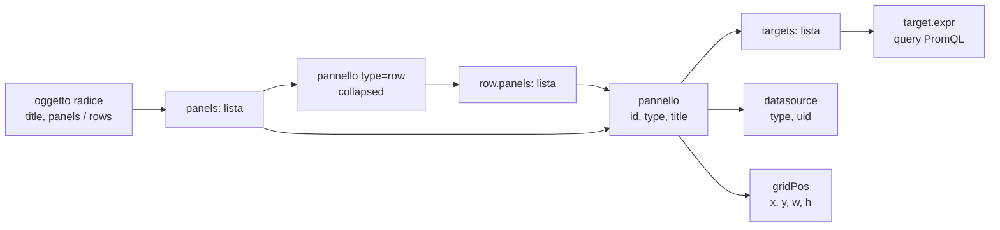
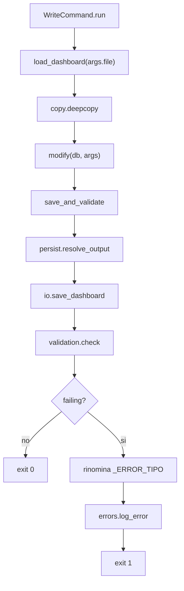
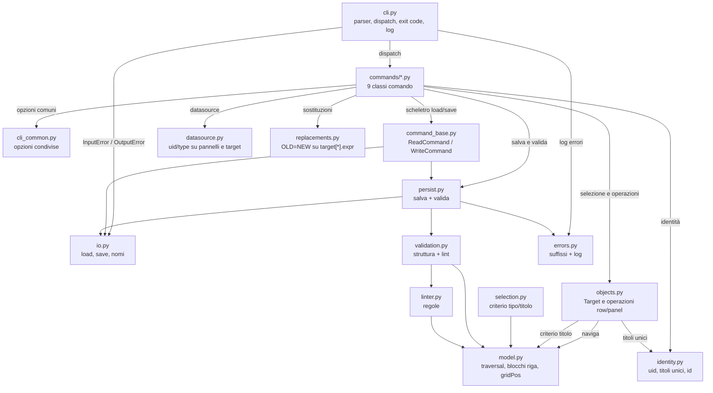

# grafana-tool

CLI per leggere, validare e modificare dashboard Grafana (JSON) da terminale.

Il progetto segue il **Single Responsibility Principle**: ogni file ha una sola responsabilità, ogni comando è una classe in `commands/`, la CLI fa solo wiring. Versione corrente: **5.0.0**.

Garanzie del contratto:

- il **file di input non viene mai modificato**;
- ogni comando di scrittura produce **sempre un file di output**;
- gli oggetti creati hanno **identificativi nuovi** (uid dashboard, id pannelli) e non riusano quelli già noti;
- la **validazione finale** (struttura + lint) è l'ultimo passo di ogni modifica;
- ogni errore produce un **log** in `out/` e un exit code dedicato;
- nessuna dipendenza esterna (solo standard library).

---

## Indice

1. [Installazione e avvio](#installazione-e-avvio)
2. [Modello dati](#modello-dati)
3. [Modello dei comandi](#modello-dei-comandi)
4. [Selettori](#selettori)
5. [`objects.py`: righe e pannelli intercambiabili](#objectspy-righe-e-pannelli-intercambiabili)
6. [Nomi dei file e contratto I/O](#nomi-dei-file-e-contratto-io)
7. [Opzioni comuni](#opzioni-comuni)
8. [Identità e nomi degli oggetti in output](#identità-e-nomi-degli-oggetti-in-output)
9. [Pipeline di scrittura e validazione](#pipeline-di-scrittura-e-validazione)
10. [Errori e log](#errori-e-log)
11. [I comandi in dettaglio](#i-comandi-in-dettaglio)
12. [Linter](#linter)
13. [Architettura](#architettura)
14. [File principali del modulo](#file-principali-del-modulo)
15. [Test](#test)
16. [Limiti noti](#limiti-noti)

---

## Installazione e avvio

### Requisiti

- Python **3.9+**;
- nessuna dipendenza di runtime (`dependencies = []` in `pyproject.toml`);
- build con `setuptools>=61`.

### Installazione

```bash
# dalla radice del repository
python3 -m pip install -e .
```

### Due modi di avvio

```bash
grafana-utils --version            # console script
python3 -m grafana_tool --version  # modulo, via __main__.py
```

Entrambi stampano `grafana-utils 5.0.0`.

```toml
[project.scripts]
grafana-utils = "grafana_tool.cli:main"
```

---

## Modello dati

Il file è un oggetto JSON. Una dashboard contiene righe e pannelli:

- **schema moderno**: `panels` mescola pannelli e contenitori `type: "row"`, i cui figli stanno in `row.panels`;
- **schema legacy**: la lista `rows` contiene direttamente le righe;
- **riga espansa**: se `row.collapsed` è `false` Grafana **non** mette i figli in `row.panels`: i pannelli restano top-level subito dopo la riga, fino alla riga successiva.

`model.row_children(db, row)` restituisce i pannelli della riga in entrambe le rappresentazioni; `model.iter_panel_slots(db)` è l'attraversamento unico usato per selezionare, elencare, spostare e rimuovere i pannelli.



### API di `model.py`

| Funzione | Comportamento |
| --- | --- |
| `iter_panels(panels)` | Itera ricorsivamente i pannelli di una lista, inclusi quelli annidati. Ignora gli elementi non-dict. |
| `iter_rows(db)` | Itera le righe unendo `db["panels"]` (solo `type=row`) e `db["rows"]`, senza duplicati per identità. |
| `iter_all_panels(db)` | Itera tutti i pannelli, righe comprese, sia da `panels` sia da `rows`, senza duplicati. |
| `iter_panel_slots(db)` | Itera `(contenitore, indice, pannello, riga)` per ogni pannello di contenuto. `riga` è la riga che lo possiede, anche quando è fratello top-level di una riga espansa. Le righe non vengono restituite. |
| `dashboard_roots(db)` | Elementi top-level di `panels` e `rows`, deduplicati per identità. |
| `expanded_row_siblings(db, row)` | Pannelli top-level che seguono una riga espansa fino alla riga successiva. |
| `row_children(db, row)` | Pannelli della riga: `row["panels"]` se presente e non vuoto; altrimenti, per `collapsed is False`, i fratelli top-level; altrimenti lista vuota. |
| `iter_rows_with_children(db)` | Coppie `(riga, pannelli)` risolte con `row_children`. |
| `find_row(db, row_id)` | Riga con quell'`id`, oppure `None`. |
| `require_row(db, row_id)` | Come `find_row`, ma solleva `ValueError` se la riga non esiste. |
| `find_row_container(db, row_id)` | `(lista_contenitrice, indice)` della riga, oppure `(None, -1)`. |
| `row_block(db, row_id)` | `(contenitore, indice, riga)`; solleva `ValueError` se la riga non esiste. |
| `find_panel_container(db, panel_id)` | `(lista_contenitrice, indice)` del pannello, ovunque sia annidato. `(None, -1)` se assente. |
| `get_max_id(db)` | Massimo `id` intero tra tutti i pannelli, righe comprese; `0` se non ce ne sono. |
| `max_y(db)` | Massimo `gridPos.y + gridPos.h` tra tutti i pannelli, annidati compresi. |
| `title_regex(pattern)` | `re.compile(pattern, re.IGNORECASE)`: punto unico per l'identificazione per nome. |
| `renumber_ids(obj, base_id)` | Assegna `obj["id"]`, poi id consecutivi ai figli e ai nipoti. Ritorna il primo id libero. |
| `insert_row_after_block(db, row_id, new_row)` | Inserisce `new_row` dopo il blocco della riga (per una riga espansa, dopo i fratelli). |
| `remove_row_block(db, row_id)` | Rimuove la riga e i suoi pannelli; ritorna quanti pannelli di contenuto sono stati rimossi. |
| `append_to_row_block(db, row, panel)` | Aggiunge `panel` dentro `row["panels"]`, o top-level in coda al blocco per una riga espansa. |
| `min_grid_y(db_or_panels)` | Minimo `gridPos.y` tra i pannelli indicati; `0` se non ce ne sono. |
| `shift_grid_y(panels, delta)` | Somma `delta` a `gridPos.y` di ogni pannello, annidati compresi; no-op con `delta = 0`. |
| `shift_dashboard_grid_y(db, delta)` | Come `shift_grid_y` ma sulle radici della dashboard. |
| `stack_grid_y(panels, start_y)` | Dispone i pannelli in colonna da `start_y` e ritorna l'altezza usata. |

---

## Modello dei comandi

Tutti i comandi hanno la stessa forma:

```text
grafana-utils <verbo> <tipo> <file> [selettori] [impostazioni]
```

Il blocco CRUD è **unificato**: non esiste un comando per tipo di oggetto. Il tipo è un argomento posizionale con `choices=("row", "panel")`, aggiunto da `cli_common.add_kind_argument`.

| Comando | Cosa fa | Tipo | Scrive | Valida |
| --- | --- | --- | --- | --- |
| `list` | Elenca righe o pannelli | `row`/`panel` | no | no |
| `create` | Crea da `--from-id` o `--template` | `row`/`panel` | sì | sì |
| `update` | Aggiorna titolo, stato, query, datasource | `row`/`panel` | sì | sì |
| `delete` | Elimina righe o pannelli | `row`/`panel` | sì | sì |
| `move` | Sposta righe o pannelli | `row`/`panel` | sì | sì |
| `extract` | Estrae un oggetto in una dashboard minima | `row`/`panel` | sì | sì |
| `layout` | Ricalcola i `gridPos` | — | sì | sì |
| `validate` | Struttura + lint | — | no | sì |
| `lint` | Solo regole di best practice | — | no | solo lint |

I comandi sostituiti dalla 5.0: `list-rows`, `list-panels`, `duplicate-row`, `copy-panel`, `update-row`, `delete-row`, `move-panel`, `replace`, `transform`, `prune`, `set-datasource`, `reflow`, `append-row`, `extract-row`.

### Matrice di simmetria

| Operazione | `row` | `panel` | Note |
| --- | --- | --- | --- |
| `list` | sì | sì | |
| `create --from-id` | sì | sì | |
| `create --template` | sì | sì | per le righe esiste un template predefinito |
| `update --title` | sì | sì | |
| `update --replace` | sì | sì | su una riga vale per tutti i suoi pannelli |
| `update --datasource` | sì | sì | su una riga vale per tutti i suoi pannelli |
| `update --collapsed/--expanded` | sì | no | un pannello non è un contenitore |
| `delete` | sì | sì | |
| `delete --keep-children` | sì | no | un pannello non ha figli propri |
| `move --position/--before/--after` | sì | sì | |
| `move --to-row` | no | sì | le righe non si annidano |
| `extract` | sì | sì | |

Le due asimmetrie sono strutturali. In entrambi i casi il comando **rifiuta** l'opzione con un `ValueError` esplicito, invece di ignorarla.

---

## Selettori

Gli stessi quattro selettori valgono per ogni verbo e per ogni tipo. `cli_common.add_selectors(parser)` li aggiunge in un solo punto.

| Selettore | Tipo | Destinazione `argparse` | Validità | Effetto |
| --- | --- | --- | --- | --- |
| `--id N` | int, `action="append"` | `args.id` | sempre | Seleziona per id; ripetibile |
| `--match-title REGEX` | regex | `args.match_title` | sempre | `re.search` sul titolo, sempre `IGNORECASE` |
| `--match-type TIPO` | stringa | `args.match_type` | solo `panel` | Confronto con `type` via `casefold` |
| `--in-row N` | int | `args.in_row` | solo `panel` | Limita ai pannelli della riga |

Regola mnemonica: **`--match-*` seleziona, le altre opzioni impostano**. `--title` è il nuovo titolo, `--match-title` è il filtro.

La validazione vive in `objects.select_targets`, che solleva `ValueError` per `--in-row`/`--match-type` usati con `row` e per gli id mancanti. Se un `--id` appartiene a una riga ma è stato chiesto `panel`, il messaggio suggerisce il tipo giusto.

`objects.require_selector` impedisce le operazioni distruttive senza criterio: `delete`, `move` ed `extract` non partono senza almeno un selettore. `list` e `update` senza selettori lavorano su tutti gli oggetti del tipo.

---

## `objects.py`: righe e pannelli intercambiabili

Il modulo è il livello che rende i due tipi intercambiabili. Non conosce argparse.

```python
ROW = "row"
PANEL = "panel"

@dataclass
class Target:
    kind: str                      # ROW | PANEL
    obj: dict                      # il pannello o la riga
    parent: dict | None = None     # riga contenitrice (pannelli)

def select_targets(db, kind, *, ids=(), match_title=None,
                   match_type=None, in_row=None) -> list[Target]: ...
def find_target(db, kind, obj_id) -> Target: ...
def content_panels(db, target) -> list[dict]: ...
def set_title(db, target, title, *, dedupe=False) -> str: ...
def set_collapsed(db, target, collapsed) -> None: ...
def remove(db, target, *, keep_children=False) -> int: ...
def move_panel(db, target, row_id, *, position="bottom") -> None: ...
def move_panel_relative(db, target, anchor_id, *, after) -> None: ...
def insert_in_row(db, row, panel, *, position="bottom") -> None: ...
def move_row(db, target, *, before=None, after=None, position="bottom") -> None: ...
```

Punti chiave:

- **`Target` non memorizza indici**: le posizioni sono risolte di nuovo a ogni modifica con `find_row_container`/`find_panel_container`. Così elimina o sposta più oggetti in sequenza senza indici stantii.
- **`content_panels`** è la definizione unica di "contenuto": per un pannello è il pannello stesso (più gli annidati), per una riga sono tutti i suoi pannelli. Le righe sono sempre escluse. È il motivo per cui `update row --replace` e `update panel --replace` funzionano allo stesso modo.
- **`remove`** con `keep_children` promuove i figli di una riga a top-level; per lo schema legacy li sposta in `db["panels"]`, perché `db["rows"]` contiene solo righe.
- **`move_panel`** reimplementa la destinazione tramite `insert_in_row`, condivisa con `create`.

---

## Nomi dei file e contratto I/O

### Input

Il file di input deve esistere e contenere un oggetto JSON. **Non viene mai scritto**.

| Situazione | Eccezione | Exit |
| --- | --- | --- |
| Il path non esiste | `InputError` | 2 |
| Il path è una directory | `InputError` | 2 |
| JSON malformato | `InputError` | 2 |
| Errore di lettura | `InputError` | 2 |
| Radice non oggetto | `InputError` | 2 |

### Output

| Situazione | Nome del file |
| --- | --- |
| Scrittura riuscita, `-o` omesso | `<input>_out.json` (stessa directory) |
| Scrittura riuscita, `-o FILE` | `FILE` |
| Validazione fallita, `-o` omesso | `<input>_out_ERROR_<TIPO>.json` |
| Validazione fallita, `-o FILE` | `<stem di FILE>_ERROR_<TIPO>.json` |
| `--dry-run` | Nessun file; se la validazione fallisce stampa il nome ipotetico |

```text
dashboard.json                       → dashboard_out.json
dashboard.json + errore di lint      → dashboard_out_ERROR_LINT_ERROR.json
dashboard.json -o build/new.json     → build/new.json
build/new.json + errore strutturale  → build/new_ERROR_VALIDATION_ERROR.json
```

I due soli `<TIPO>` che compaiono nel nome del file sono `VALIDATION_ERROR` e `LINT_ERROR`. Gli altri errori producono solo un log.

`io.save_dashboard` crea le directory genitore mancanti, sovrascrive il file di output se esiste e serializza con `json.dump(indent=2, ensure_ascii=False)` più un newline finale. Con `dry_run=True` non tocca il disco.

---

## Opzioni comuni

`cli_common.py` è l'unico posto in cui vivono i flag condivisi: testo, default e `choices` non vengono ripetuti nei comandi.

| Helper | Flag aggiunti |
| --- | --- |
| `add_file_argument` | argomento posizionale `file` |
| `add_kind_argument` | argomento posizionale `kind` con `choices=("row","panel")` |
| `add_selectors` | `--id`, `--match-title`, `--match-type`, `--in-row` |
| `add_write_options` | `-o/--output`, `--dry-run`, `--severity` |
| `add_severity_option` | `--severity` (usato anche da `validate` e `lint`) |
| `add_format_option` | `--format text\|json` (usato da `list` e `lint`) |
| `add_title_option` | `--title` |
| `add_dedupe_option` | `--dedupe-titles` |
| `add_collapsed_options` | `--collapsed`, `--expanded` (stessa destinazione `args.collapsed`) |
| `add_replace_option` | `--replace OLD=NEW`, ripetibile |
| `add_datasource_options` | `--datasource`, `--datasource-type`, `--datasource-create` |

I comandi non ridefiniscono mai queste opzioni: implementano `add_arguments` e `add_common_options` riceve `file` e le opzioni di scrittura dalla classe base.

Destinazioni `argparse` rilevanti: `args.output`, `args.dry_run`, `args.severity`, `args.dedupe_titles`, `args.datasource_type`, `args.datasource_create`, `args.in_row`, `args.base_id`, `args.on_existing`.

---

## Identità e nomi degli oggetti in output

Il tool non interroga Grafana. Quello che può garantire è che **gli identificativi scritti nel file di output non riusino quelli già noti** (dashboard sorgente e inventario passato con `--existing-dashboards`). La logica vive in `identity.py`, che è pura.

### Tre livelli di identità

- **dashboard**: `uid` globale, 9 caratteri `[A-Za-z0-9]` generati con `secrets`, verificati contro l'inventario; `id` posto a `null`; `version` a `1`. Così Grafana crea una dashboard nuova e non aggiorna quella esistente.
- **pannello**: l'`id` è un intero unico *dentro* la dashboard. `create` ed `extract` partono da `max + 1` o da `--base-id` e verificano l'intervallo con `id_range_collisions`: un `--base-id` in conflitto è un errore, non una rinumerazione silenziosa.
- **titolo**: è un'etichetta, non una chiave. I titoli restano invariati per default; con `--dedupe-titles` diventano unici con il suffisso ` (2)`, ` (3)`.

### API di `identity.py`

| Funzione | Effetto |
| --- | --- |
| `new_uid(length=9)` | uid casuale nello stile di Grafana |
| `new_uid_not_in(taken)` | uid che non compare in `taken` (case-insensitive) |
| `normalize_title(title)` | forma di confronto: spazi compattati, `casefold` |
| `unique_title(base, taken)` | `base` se libero, altrimenti `base (n)` |
| `all_titles(db)` | titoli non vuoti di righe e pannelli |
| `dedupe_panel_titles(panels, taken)` | rende unici i titoli dei pannelli (le righe sono escluse); ritorna quanti ne ha riscritti |
| `parse_inventory(data)` | `(uid, titoli)` da `GET /api/search`, `{"dashboards": [...]}` o singola dashboard |
| `seal_new_dashboard(db, uid, title, taken_uids, taken_titles)` | uid verificato, `id=None`, `version=1`, titolo unico |
| `id_range_collisions(db, base, count)` | id già presenti che cadrebbero nell'intervallo richiesto |
| `extend_text(target, value)` | aggiunge `value` a un set se è testo non vuoto |

Un `--uid` esplicito già in uso è un errore: non è possibile "indovinare" un altro identificativo richiesto dall'utente. Un titolo già in uso riceve invece il suffisso.

---

## Pipeline di scrittura e validazione



`persist.save_and_validate(db, args)`:

1. risolve il file di output (`-o`, altrimenti `<input>_out.json`);
2. scrive il file senza mai toccare l'input;
3. esegue `validation.check(db, args.severity)` sull'oggetto in memoria;
4. se fallisce, rinomina il file appendendo `_ERROR_<TIPO>` e registra il log;
5. restituisce 0 oppure 1.

`validation.check` produce un `Result` con `errors` (struttura), `issues` (lint), `threshold`, e le proprietà `blocking`, `failing`, `kind`. La priorità del tipo di errore è `validation` se ci sono errori strutturali, altrimenti `lint`.

---

## Errori e log

Ogni errore è classificato e scritto in `out/<tipo>_error_<AAAAMMGG-HHMMSS>.txt`. La directory si sposta con `GRAFANA_TOOL_LOG_DIR` (i test la usano per non sporcare il repository). Se il log non è scrivibile viene saltato: un log mancante non maschera mai l'errore originale.

| Tipo | `ERROR_KINDS` | Quando | Exit |
| --- | --- | --- | --- |
| `input` | `INPUT_ERROR` | file assente, non leggibile, JSON non valido, radice non oggetto | 2 |
| `usage` | `USAGE_ERROR` | comando o argomenti non validi | 2 |
| `output` | `OUTPUT_ERROR` | path di output non scrivibile | 3 |
| `command` | `COMMAND_ERROR` | selettore mancante, oggetto inesistente, opzione incoerente | 1 |
| `validation` | `VALIDATION_ERROR` | ID duplicati o mancanti | 1 |
| `lint` | `LINT_ERROR` | issue con severità pari o superiore alla soglia | 1 |

`cli.main` traduce le eccezioni: `InputError` → 2, `OutputError` → 3, `ValueError` → 1. `CommandParser.error` registra gli errori d'uso prima di uscire con 2.

---

## I comandi in dettaglio

Tutti i comandi di scrittura accettano `-o`, `--dry-run` e `--severity` (vedi [Opzioni comuni](#opzioni-comuni)), non modificano l'input e terminano con la validazione finale.

Gli esempi usano `examples/full_dashbaord.json`: dashboard di produzione con 6 righe (l'ultima, `id` 125 "VITA - VISTA PV - Sistemistica --> GEN2", è espansa) e 90 pannelli di contenuto, 16 dei quali top-level e appartenenti alla riga espansa.

### `list`

```bash
grafana-utils list row examples/full_dashbaord.json
grafana-utils list panel examples/full_dashbaord.json --in-row 125
grafana-utils list panel examples/full_dashbaord.json --format json
```

Output righe: `ID`, `Titolo`, `Pannelli`, `Collapsed`; la colonna `Pannelli` conta con `row_children`, quindi include i fratelli top-level delle righe espanse. Output pannelli: `- [id] tipo: titolo  (riga N | nessuna riga)` seguito dalle `expr` troncate a 100 caratteri.

Con `--format json` produce un array di oggetti: `{kind, id, title, collapsed, panel_count}` per le righe, `{kind, id, title, type, row_id}` per i pannelli.

Note implementative: i target vengono da `objects.select_targets`, quindi l'ordine è quello della dashboard. Se la selezione è vuota stampa `Nessuna riga trovata.` / `Nessun pannello trovato.` ed esce con 0.

### `create`

Due sorgenti, uguali per entrambi i tipi:

- `--from-id N` copia un oggetto esistente (con i figli);
- `--template FILE` istanzia un template, applicando `${...}` e `--replace`.

Per le righe il template ha un default (`templates/system-view.row.tpl.json`), quindi `create row` senza sorgente riproduce la riga di sistema; per i pannelli la sorgente è obbligatoria.

```bash
grafana-utils create row   dashboard.json --from-id 125 --dedupe-titles
grafana-utils create row   dashboard.json --namespace pa-digital --cluster-gen 3 --title "VISTA TEST"
grafana-utils create panel dashboard.json --from-id 12 --to-row 125 --replace "gen2=gen3"
```

| Opzione | Tipo | Default | Obbligo / dipendenze |
| --- | --- | --- | --- |
| `--from-id N` | int | — | alternativa a `--template` |
| `--template FILE` | path | template di sistema per `row` | alternativa a `--from-id`; obbligatoria per `panel` |
| `--title T` | stringa | titolo della sorgente | opzionale; non può essere vuoto |
| `--dedupe-titles` | flag | off | opzionale |
| `--collapsed`/`--expanded` | flag | `collapsed` | solo `row` |
| `--to-row N` | int | stessa riga della sorgente | solo `panel` |
| `--position {top,bottom}` | scelta | `bottom` | opzionale |
| `--replace OLD=NEW` | ripetibile | vuoto | opzionale |
| `--base-id N` | int | `max + 1` | opzionale |
| `--params FILE` | path | — | con `--template` |
| `--namespace`, `--cluster-gen`, `--datasource-uid`, `--title-prefix` | stringa | `universo-on-line-feu-up`, `2`, `QEIISg1Vz`, `""` | con `--template` |
| `--namespace-exact` | flag | off | con `--template` |
| `--on-existing {error,replace,skip,append}` | scelta | `error` | solo `row` con `--template` |

Note implementative:

1. `_load_template` usa il path così com'è se esiste, altrimenti lo cerca rispetto alla radice del progetto.
2. `_pick_template_object` accetta sia un oggetto del tipo giusto sia una dashboard da cui prende il primo `type=row` o il primo pannello non-row.
3. `_build_params` assembla: file `--params` → override CLI (incluso `--title` per `${ROW_TITLE}`) → default → `ROW_TITLE` derivato da `NAMESPACE`.
4. `_build_row` con `--from-id` copia la riga e i figli risolti con `row_children`, quindi funziona anche sulle righe espanse.
5. `--on-existing` confronta il titolo normalizzato con `normalize_title`; `replace` usa `remove_row_block`, che rimuove anche i fratelli top-level di una riga espansa.
6. `_assign_ids` conta i pannelli con `iter_panels`, verifica `id_range_collisions` e chiama `renumber_ids`.
7. `_place_row` gestisce `--position top` traslando la dashboard con `shift_dashboard_grid_y` e disponendo i figli esplosi con `stack_grid_y`; una riga `--expanded` emette i figli top-level subito dopo.
8. `_place_panel` usa `insert_in_row` con `--to-row`, altrimenti inserisce accanto all'originale, altrimenti in fondo alla dashboard.

### `update`

Applica una o più modifiche; almeno una impostazione è obbligatoria.

```bash
grafana-utils update row   dashboard.json --id 125 --title "VISTA SISTEMISTICA"
grafana-utils update row   dashboard.json --id 125 --expanded
grafana-utils update row   dashboard.json --id 125 --datasource prom-new --datasource-type prometheus
grafana-utils update panel dashboard.json --match-type timeseries --match-title "^POD" --replace "gen2=gen3"
```

| Opzione | Tipo | Default | Obbligo / dipendenze |
| --- | --- | --- | --- |
| `--title T` | stringa | — | almeno un'impostazione |
| `--dedupe-titles` | flag | off | con `--title` |
| `--collapsed`/`--expanded` | flag | — | solo `row` |
| `--replace OLD=NEW` | ripetibile | vuoto | almeno un'impostazione |
| `--datasource UID` | stringa | — | almeno un'impostazione |
| `--datasource-type TIPO` | stringa | — | richiede `--datasource` |
| `--datasource-create` | flag | off | richiede `--datasource` |

Note implementative: il comando valida prima le dipendenze (`--datasource-type` e `--datasource-create` senza `--datasource` sono errori) e poi la presenza di almeno una modifica. Per ogni target stampa una riga `riga 5 'Row B': titolo 'X', 3 modifiche al contenuto` e chiude con il conteggio. Le operazioni di contenuto passano da `objects.content_panels`, quindi su una riga coinvolgono tutti i suoi pannelli.

### `delete`

```bash
grafana-utils delete panel dashboard.json --id 12
grafana-utils delete panel dashboard.json --match-title "^DEBUG" --dry-run
grafana-utils delete row   dashboard.json --match-title "^VISTA" --keep-children
```

Il selettore è obbligatorio. Eliminare una riga elimina anche i pannelli che le appartengono, righe espanse comprese (`remove_row_block`); `--keep-children` li promuove a top-level. Su `panel`, `--keep-children` è un errore.

### `move`

```bash
grafana-utils move panel dashboard.json --id 12 --to-row 125
grafana-utils move panel dashboard.json --in-row 5 --to-row 125
grafana-utils move panel dashboard.json --id 12 --after 14
grafana-utils move row   dashboard.json --id 125 --position top
grafana-utils move row   dashboard.json --id 125 --after 112
```

| Opzione | Tipo | Default | Obbligo / dipendenze |
| --- | --- | --- | --- |
| `--to-row N` | int | — | solo `panel`; alternativo a `--before`/`--after` |
| `--before N` | int | — | alternativo a `--to-row` e `--after` |
| `--after N` | int | — | alternativo a `--to-row` e `--before` |
| `--position {top,bottom}` | scelta | `bottom` | con `--to-row` o da solo |

Per i pannelli `--to-row` sposta in un'altra riga (`objects.move_panel`, che usa `insert_in_row`), mentre `--before`/`--after` riordinano dentro il contenitore dell'ancora (`objects.move_panel_relative`). Per le righe vale `objects.move_row`, che rifiuta `--to-row` e le righe dello schema legacy. `--to-row` insieme a `--before`/`--after` è un errore.

### `extract`

```bash
grafana-utils extract row   dashboard.json --id 125 -o vista.json
grafana-utils extract panel dashboard.json --id 12  -o pannello.json
grafana-utils extract row   dashboard.json --match-title "Sistemistica" --existing-dashboards inv.json
```

| Opzione | Tipo | Default | Obbligo / dipendenze |
| --- | --- | --- | --- |
| `--title T` | stringa | titolo dell'oggetto | opzionale |
| `--uid U` | stringa | generato | opzionale |
| `--existing-dashboards FILE` | path | — | opzionale |
| `--base-id N` | int | `max + 1` della sorgente | opzionale |
| `--dedupe-titles` | flag | off | opzionale |

Accetta **un solo oggetto**: con più match è un errore. Una riga espansa conserva la forma originale (riga + fratelli top-level), una collassata i figli annidati; un pannello produce una dashboard con un solo pannello e `gridPos` di default `{h: 8, w: 12, x: 0, y: 0}`.

Note implementative: `_block` costruisce le radici, poi il comando riassegna gli id in sequenza da `--base-id` (o `get_max_id(sorgente) + 1`), disambigua i titoli, trasla `gridPos` con `shift_grid_y` perché parta da `y = 0`, costruisce la dashboard con `dashboard_factory.minimal_dashboard` (che eredita `time`, `timezone`, `refresh`, `templating`, `schemaVersion`) e la sigilla con `seal_new_dashboard`.

### `layout`, `validate`, `lint`

`layout` ricalcola i `gridPos` riga per riga: `--in-row N`, `--columns` (default 24, deve essere > 0), `--default-width` (12), `--default-height` (8). Per ogni riga si parte da `x = 0`; se `x + w` supera `--columns` e `x > 0` si va a capo. Le righe espanse partono da `y = 1` e restano espanse; quelle collassate ricevono `collapsed: true` e i figli partono da `y = 0`. I pannelli top-level fuori riga non vengono toccati.

`validate` esegue struttura e lint ed è lo stesso controllo che chiude ogni scrittura. `lint` esegue solo le regole di best practice e accetta `--format text|json`. In caso di fallimento il percorso del log va su stderr se il formato è `json`, così il JSON resta parsabile.

---

## Linter

| Codice | Severità | Regola |
| --- | --- | --- |
| `MISSING_PANEL_ID` | error | pannello senza campo `id` |
| `DUPLICATE_PANEL_ID` | error | stesso `id` su più pannelli |
| `MISSING_TITLE` | warning | pannello di contenuto senza titolo |
| `MISSING_TARGETS` | warning | pannello dati senza `targets` |
| `DUPLICATE_QUERY` | warning | stessa `expr` in più pannelli |
| `MISSING_DATASOURCE` | warning | pannello con target ma senza datasource esplicito |
| `EMPTY_ROW` | warning | riga vuota e non collassata |
| `SHARED_LIBRARY_PANEL` | info | pannello legato a una `libraryPanel` esterna |
| `MISSING_UNIT` | info | pannello numerico senza unità di misura |

Le regole sono sottoclassi di `Rule` con `code`, `severity` e `check(db)`; il motore `lint(db, rules)` applica `DEFAULT_RULES`. Per aggiungere una regola basta definire la classe e appenderla a `DEFAULT_RULES`. La soglia usa `validation.SEV_ORDER` (`info=1`, `warning=2`, `error=3`) e le etichette `SEV_LABEL` (`INFO`, `WARN`, `ERR`).

---

## Architettura

### Struttura dei file

```text
grafana/
├── pyproject.toml
├── README.md                      # guida per chi usa la CLI
├── AGENTS.md                      # questo documento
├── templates/
│   ├── system-view.row.tpl.json   # template row con placeholder ${...}
│   └── variable.yml               # parametri placeholder (valori vuoti = ignorati)
├── examples/
│   └── full_dashbaord.json        # dashboard di produzione (6 righe, 90 pannelli)
├── tests/                         # suite unittest
│   ├── support.py                 # fixture e runner CLI
│   ├── test_objects.py            # selezione e operazioni comuni row/panel
│   ├── test_crud.py               # matrice create/update/delete/move/extract
│   ├── test_commands_read.py      # list, validate, lint
│   ├── test_layout.py
│   └── test_integration_example.py
└── grafana_tool/
    ├── __init__.py          → versione e docstring
    ├── __main__.py          → entry point `python -m grafana_tool`
    ├── cli.py               → argparse + dispatch + exit code + log
    ├── cli_common.py        → opzioni condivise (tipo, selettori, valori)
    ├── command_base.py      → BaseCommand, ReadCommand, WriteCommand
    ├── objects.py           → Target, selezione e operazioni row/panel
    ├── model.py             → traversal righe/pannelli, blocchi, gridPos
    ├── selection.py         → PanelMatcher: criterio tipo/titolo
    ├── identity.py          → uid, titoli unici, id dei pannelli
    ├── datasource.py        → aggiornamento blocchi datasource
    ├── replacements.py      → parsing e applicazione di OLD=NEW
    ├── placeholders.py      → motore ricorsivo ${CHIAVE}
    ├── namespace_normalizer.py → namespace="x" → namespace=~"x"
    ├── params.py            → caricamento parametri JSON/YAML
    ├── dashboard_factory.py → factory per dashboard minime
    ├── io.py                → load/save, nomi di default e suffissi
    ├── persist.py           → pipeline "salva + valida"
    ├── validation.py        → struttura + lint, report condiviso
    ├── linter.py            → Issue, Rule, regole, engine
    ├── errors.py            → tipi di errore, suffissi, log in out/
    └── commands/
        ├── __init__.py      → registro ALL_COMMANDS
        ├── list.py          → ListCommand (ReadCommand)
        ├── create.py        → CreateCommand (WriteCommand)
        ├── update.py        → UpdateCommand (WriteCommand)
        ├── delete.py        → DeleteCommand (WriteCommand)
        ├── move.py          → MoveCommand (WriteCommand)
        ├── extract.py       → ExtractCommand (WriteCommand)
        ├── layout.py        → LayoutCommand (WriteCommand)
        ├── validate.py      → ValidateCommand (ReadCommand)
        └── lint.py          → LintCommand (ReadCommand)
```

### Principi di ingegneria del software applicati

| Principio | Dove | Scelta |
| --- | --- | --- |
| **Single Responsibility Principle** | Ogni modulo | `io` = serializzazione, `model` = traversal, `objects` = operazioni comuni ai due tipi, `selection` = criteri di match, `linter` = regole, `persist` = pipeline, `errors` = classificazione/log, `identity` = uid/titoli/id, `datasource` = blocchi datasource, `dashboard_factory` = dashboard minime, `command_base` = scheletro dei comandi. |
| **Template Method** | `command_base.ReadCommand`, `WriteCommand` | Lo scheletro `load → perform` e `load → deep-copy → modify → save_and_validate` è definito una volta sola. I comandi implementano solo `add_arguments`, `perform` o `modify`. |
| **Strategy per tipo** | `objects.py` | Un `Target` conosce il proprio `kind`; le operazioni scelgono il ramo giusto e condividono selezione, contenuto, rimozione e spostamento. Nessun `if kind == ...` sparso nei comandi. |
| **Value Object** | `selection.PanelMatcher`, `objects.Target` | Criterio e oggetto selezionato sono oggetti piccoli e immutabili per il matcher, con un solo metodo pubblico. |
| **Open/Closed** | `linter.DEFAULT_RULES` | Le regole si aggiungono alla lista senza modificare il motore. |
| **Immutabilità difensiva** | `WriteCommand.run` | Il dashboard caricato viene deep-copiato prima di `modify`. |
| **Un solo punto per ogni opzione** | `cli_common.py` | Nessun comando riscrive testo, default o `choices` di un flag condiviso. |

### Dipendenze fra moduli



`io.py` non conosce Grafana né i comandi; `linter.py` non conosce il disco; `validation.py` unisce i due punti di vista e non scrive nulla; `persist.py` è l'unico che orchestra scrittura, validazione e log; `objects.py` non conosce argparse.

### Contratto di un comando

| Attributo | Tipo | Uso |
| --- | --- | --- |
| `NAME` | `str` | Nome del subparser |
| `HELP` | `str` | Testo nella lista dei comandi |
| `add_arguments(parser)` | funzione | Opzioni specifiche |
| `configure(parser)` | funzione (base) | Chiama `add_arguments` e `add_common_options` |
| `run(args)` | funzione (base) | Esegue e restituisce l'exit code |
| `perform(db, args)` | hook | Logica dei comandi read-only |
| `modify(db, args)` | hook | Trasformazione dei comandi di scrittura |

Ogni modulo comando esporta `command`, un'istanza raccolta in `ALL_COMMANDS`. Per aggiungerne uno: crea la classe, implementa `add_arguments` e `perform` o `modify`, istanziala come `command`, registrala.

---

## File principali del modulo

### `cli.py` — parsing, dispatch, exit code

```python
class CommandParser(argparse.ArgumentParser):
    """Parser che registra gli errori d'uso in `out/` prima di uscire con 2."""
    def error(self, message: str) -> None:
        errors.log_error("usage", message, command=self.prog,
                         argv=self.argv, exit_code=2)
        super().error(message)


def build_parser(argv=None):
    p = CommandParser(prog="grafana-utils", ...)
    p.add_argument("--version", action="version", ...)
    sub = p.add_subparsers(dest="cmd", required=True)
    for cmd in ALL_COMMANDS:
        sp = sub.add_parser(cmd.NAME, help=cmd.HELP)
        cmd.configure(sp)
        sp.set_defaults(func=cmd.run)
    return p
```

`main` traduce le eccezioni in exit code (`InputError` 2, `OutputError` 3, `ValueError` 1) e registra il log con `errors.log_error`.

### `command_base.py` — classi base

```python
class BaseCommand:
    def configure(self, parser):
        self.add_arguments(parser)
        self.add_common_options(parser)

class ReadCommand(BaseCommand):
    def add_common_options(self, parser):
        add_file_argument(parser)

    def run(self, args):
        return self.perform(load_dashboard(args.file), args)

class WriteCommand(BaseCommand):
    def add_common_options(self, parser):
        add_file_argument(parser)
        add_write_options(parser)

    def modify(self, db, args):
        return db

    def report_renamed(self, count):
        if count:
            print(f"Titoli pannelli disambiguati: {count}.")

    def run(self, args):
        db = copy.deepcopy(load_dashboard(args.file))
        return save_and_validate(self.modify(db, args), args)
```

### `objects.py` — selezione e operazioni comuni

```python
@dataclass
class Target:
    kind: str
    obj: dict
    parent: dict | None = None


def select_targets(db, kind, *, ids=(), match_title=None,
                   match_type=None, in_row=None) -> list[Target]:
    _validate_selectors(kind, match_type, in_row)
    if in_row is not None:
        require_row(db, in_row)
    ...
    # filtra per id, regex sul titolo, tipo e riga; poi verifica gli id mancanti
```

```python
def content_panels(db, target):
    roots = [c for c in row_children(db, target.obj) if isinstance(c, dict)] \
        if target.kind == ROW else [target.obj]
    return [p for p in iter_panels(roots) if p.get("type") != "row"]
```

### `selection.py` — criterio tipo/titolo

`PanelMatcher` è un `frozen dataclass` con `panel_type`, `title` (regex) e `matches(panel)`. Un criterio vuoto non matcha nulla: `any()` serve ai comandi per distinguere "nessun filtro" da "filtro vuoto". La stessa semantica vale per `--match-type` e `--match-title` in ogni comando.

### `identity.py` — identità e nomi

```python
def unique_title(base, taken, start=2):
    clean = " ".join(str(base or "").split()) or "Senza titolo"
    used = _normalized(taken)
    if normalize_title(clean) not in used:
        return clean
    n = start
    while normalize_title(f"{clean} ({n})") in used:
        n += 1
    return f"{clean} ({n})"


def seal_new_dashboard(db, *, uid=None, title=None, taken_uids=(), taken_titles=()):
    used_uids = _folded(taken_uids)
    candidate = str(uid).strip() if uid is not None else new_uid_not_in(used_uids)
    final_title = unique_title(title or db.get("title") or "Dashboard", taken_titles)
    db["uid"], db["id"], db["version"] = candidate, None, 1
    db["title"] = final_title
    return DashboardIdentity(candidate, final_title)
```

### `datasource.py` — blocchi datasource

```python
def apply_datasource(container, uid, ds_type=None, *, force=False) -> int:
    ds = container.get("datasource")
    if isinstance(ds, dict):
        ds["uid"] = uid
        if ds_type:
            ds["type"] = ds_type
        return 1
    if force:
        container["datasource"] = {"type": ds_type or "prometheus", "uid": uid}
        return 1
    return 0
```

`apply_datasource_to_panel` applica la stessa funzione al pannello e a `targets[*]`.

### `replacements.py`, `placeholders.py`, `namespace_normalizer.py`

Utility pure: `parse_replacements` converte `OLD=NEW` in un dizionario (split al primo `=`), `apply_in_panel` sostituisce in `target[*].expr` e ritorna quanti target ha cambiato, `apply_placeholders` sostituisce `${CHIAVE}` in tutto l'albero JSON lasciando intatti i segnaposto sconosciuti, `normalize_namespace` riscrive `namespace="x"` in `namespace=~"x"` solo nelle stringhe che contengono sia `{` sia `namespace=`.

### `dashboard_factory.py` — dashboard minime

`minimal_dashboard(title, panels, source)` costruisce lo scheletro di una dashboard e, se `source` è indicata, eredita `time`, `timezone`, `refresh`, `templating` e `schemaVersion`.

### `params.py` — parametri da file

`ParamLoader.load(path)` legge JSON o YAML (PyYAML opzionale) e scarta i valori `None` e `""`, così non sovrascrivono default né valori da CLI.

---

## Test

```bash
python3 -m unittest discover -s tests -t . -v
```

| File di test | Cosa verifica |
| --- | --- |
| `test_io.py` | load/save, errori di input e output, nomi di default, dry-run |
| `test_model.py` | traversal, righe espanse, `row_children`, `iter_panel_slots`, blocchi, `gridPos` |
| `test_objects.py` | selezione per tipo, `content_panels`, `remove`, `move`, setter |
| `test_selection.py` | `PanelMatcher`: criterio vuoto, tipo, titolo, AND |
| `test_crud.py` | matrice dei verbi su `row` e `panel`, simmetria |
| `test_commands_read.py` | `list` (testo e JSON), `validate`, `lint` |
| `test_layout.py` | `layout`, righe espanse, a capo, parametri invalidi |
| `test_command_base.py` | `ReadCommand`/`WriteCommand`, opzioni comuni, copia difensiva |
| `test_cli.py` | parser, tipo obbligatorio, selettori uniformi, exit code 0/1/2/3, log |
| `test_identity.py` | uid, titoli unici, deduplica, inventario, id di pannello |
| `test_datasource.py` | aggiornamento e creazione dei blocchi datasource |
| `test_validation.py`, `test_linter.py` | regole, soglie, priorità `validation` > `lint`, render |
| `test_persist.py`, `test_errors.py` | pipeline salva+valida, rinomina `_ERROR_*`, log |
| `test_params.py`, `test_placeholders.py`, `test_replacements.py`, `test_namespace_normalizer.py` | utility pure |
| `test_dashboard_factory.py` | dashboard minima ed ereditarietà del contesto |
| `test_integration_example.py` | estrazione e modifica della riga "VISTA SISTEMISTICA" nella dashboard di produzione |

I test isolano i log tramite `GRAFANA_TOOL_LOG_DIR`, quindi il repository non accumula file in `out/`.

---

## Limiti noti

- **La validazione legge l'oggetto in memoria**, non rilegge il file appena scritto: un filesystem che corrompe la scrittura non viene intercettato.
- **La rinomina può fallire** (permessi, path occupato): il file resta con il nome originale e il messaggio lo segnala.
- **`LINT_ERROR` nel nome del file compare solo abbassando la soglia**: le due regole di severità `error` sono anche controlli strutturali, quindi con `--severity error` un errore di lint arriva come `VALIDATION_ERROR`.
- **Log relativi alla directory corrente**: `out/` viene creato dove lanci il comando. `GRAFANA_TOOL_LOG_DIR` permette di spostarla.
- **`update --collapsed` e `delete --keep-children` valgono solo per `row`**: un pannello non è un contenitore. Il comando lo rifiuta esplicitamente.
- **`move --to-row` vale solo per `panel`**: le righe non si annidano.
- **`update` e `move` non ricalcolano `gridPos`**: dopo uno spostamento può servire `layout`.
- **`create panel` copia anche `gridPos`**: il clone può sovrapporsi all'originale finché non si esegue `layout`.
- **`layout` azzera `y` a ogni riga** e ignora i pannelli top-level fuori riga; sulle righe espanse lascia `collapsed: false` e parte da `y = 1`.
- **`--namespace-exact` esiste solo per i template**: con `--from-id` non c'è nulla da normalizzare.
- **`extract` accetta un solo oggetto per esecuzione**.
